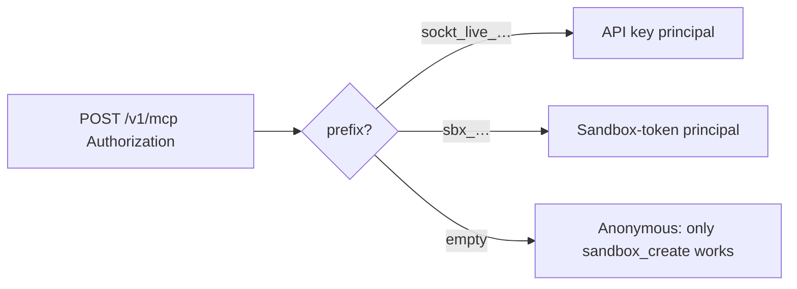

# Sockt Control Plane HTTP API Reference

This document describes the HTTP surface exposed by the **sockt control plane** (`sockt-cp`, [`cmd/control-plane`](cmd/control-plane/main.go)). It is maintained against the routes registered in [`internal/api/router.go`](internal/api/router.go).

**Scope:** Control-plane lifecycle, user/wallet/dashboard, MCP JSON-RPC over HTTP, runtime callbacks, and Stripe webhooks. Sandbox **data-plane** URLs (exec, files, shell) are not documented here unless they appear as fields on stored sandbox rows.

---

## Conventions

- **Base URL:** Deployment-specific (for example Cloud Run). Paths below are absolute from `/`.
- **Content-Type:** Use `application/json` for bodies where a JSON body is specified. Successful JSON responses use `application/json`.
- **`X-Request-ID`:** Responses include this header. If the client omitted it, the server generates one ([`recoverReqIDLog`](internal/api/respond.go)).
- **Structured errors (REST):** Most handlers use [`writeErr`](internal/api/respond.go):

  ```json
  { "code": "...", "error": "...", "message": "..." }
  ```

  alongside an appropriate HTTP status code.

- **Plain-text errors:** [`JWTAuth`](internal/auth/jwt.go) rejects missing/invalid JWTs with [`http.Error`](https://pkg.go.dev/net/http#Error) bodies (plain text such as `"missing authorization"`, `"invalid token"`), not JSON. Plan clients accordingly.

- **Rate limiting:** Sandbox REST + MCP POST share a single [`auth.NewRateLimiter(MCP_RPM)`](internal/api/router.go) (default **120 rpm per key**, with burst derived from RPM ([`internal/auth/ratelimit.go`](internal/auth/ratelimit.go))). Excess requests receive **429** with body `rate limited` (plain text). For authenticated principals the key is [`Principal.BalanceKey`](internal/auth/context.go); for anonymous MCP requests the key is `ip:<client_ip>`.

---

## JSON encoding of persisted models

Types from [`internal/store/store.go`](internal/store/store.go) (`User`, `Sandbox`, `Agent`, `TierPricing`, `BillingInterval`, `CreditTxSummary`, etc.) are serialized with **`encoding/json` defaults**: **no struct tags**, so JSON object keys match **Go exported field names** (for example `ID`, `UserID`, `CreditBalanceUSDCents`, `PodProxyURL`). Do not assume `snake_case` for these payloads.

---

## Authentication overview



| Mechanism | When | Headers / behavior |
|-----------|------|---------------------|
| **None** | Public catalog and health | No auth. |
| **User JWT** | `/v1/user/*` | `Authorization: Bearer <jwt>`. HS256, `sub` claim must be user UUID ([`JWTAuth`](internal/auth/jwt.go)). |
| **API key** | REST `/v1/sandbox/*` and MCP POST | `Authorization: Bearer sockt_live_…` ([`internal/auth/apikey.go`](internal/auth/apikey.go)). Credits sandboxes require this path. |
| **Sandbox token** | MCP POST | `Authorization: Bearer sbx_…` ([`internal/auth/sandboxtoken.go`](internal/auth/sandboxtoken.go)). Issued by the control plane in the result of `tools/call sandbox_create` for Lightning sandboxes; the LLM uses it (or passes `sandbox_token` as a tool argument) to call subsequent tools on that sandbox. |
| **Anonymous** | MCP POST | No `Authorization` header. `initialize`, `tools/list`, and `tools/call sandbox_create` are allowed; every other tool returns `forbidden` until a `sandbox_token` is presented. |
| **Callback secret** | Runtime POST callbacks | `Authorization: Bearer <CALLBACK_SECRET>` ([`BearerSecret`](internal/auth/jwt.go)). |
| **Stripe signing** | `POST /internal/webhooks/stripe` | **`Stripe-Signature`** on raw webhook body; verifies HMAC ([`verifyStripePayload`](internal/api/stripe.go)). |

### Sandbox ownership

After authentication, sandbox access checks [`canAccessSandbox`](internal/api/handlers.go): **credits/API-key** callers must match `sandbox.UserID`. Lightning sandboxes are accessed through MCP only; the matching check is the `sandbox_token` (bearer or arg) — see [`Service.principalCanAccess`](internal/mcp/service.go). Mismatches yield **403** `forbidden`.

---

## Endpoint catalog

### `GET /healthz`

**Auth:** None  
**Purpose:** Liveness / dependency sniff.

**Response 200:**

```json
{
  "ok": true,
  "lnd_connected": false,
  "supabase_ok": false,
  "runpod_configured": false
}
```

(Field semantics: non-empty transactional DSN, LND client present, `RunPodAPIKey` configured — see router implementation.)

---

### `GET /v1/pricing`

**Auth:** None  
**Purpose:** Tier pricing rows from the database.

**Response 200:** JSON array of [`TierPricing`](internal/store/store.go) (`Tier`, `MsatsPerSecond`, `USDCentsPerSecondX100`).  
**Errors:** `store_error` (500).

---

### `GET /v1/mcp/health`

**Auth:** None  
**Purpose:** MCP transport capability probe.

**Response 200:** From [`HealthPayload`](internal/mcp/mcp.go):

- `status`, `protocol_version`, `transport`, `json_rpc_per_post`.

---

### `GET /v1/mcp`

**Auth:** None (legacy MCP SSE handshake only).

**Purpose:** Opens a Server-Sent Events stream that emits one `endpoint` event with the absolute URL of the JSON-RPC POST endpoint (`…/v1/mcp`). The client must send MCP requests via **POST** with credentials; this GET does not authenticate.

---

### `POST /v1/mcp`

**Auth:** One of:

- `Authorization: Bearer sockt_live_…` — API-key principal (credits sandboxes).
- `Authorization: Bearer sbx_…` — sandbox-token principal (Lightning sandbox the token is bound to).
- *No* `Authorization` header — anonymous; only `initialize`, `tools/list`, and `tools/call sandbox_create` succeed. Every other tool returns `forbidden` until a `sandbox_token` is supplied (header or `arguments.sandbox_token`).

Single rate limit (`MCP_RPM`, default 120 rpm): keyed on the principal's `BalanceKey` when authenticated, or `ip:<client_ip>` when anonymous.

**Purpose:** Single JSON-RPC 2.0 request per POST — “Streamable HTTP MVP” ([`internal/mcp/handler.go`](internal/mcp/handler.go)). Request body capped by config (`MCPRequestBodyLimit`, default 4 MiB).

**Cursor (and similar clients):** Put your API key in `mcp.json` so every request sends `Authorization: Bearer sockt_live_…`:

```json
{
  "mcpServers": {
    "sockt": {
      "url": "https://<your-control-plane>/v1/mcp",
      "headers": {
        "Authorization": "Bearer sockt_live_..."
      }
    }
  }
}
```

**Supported methods:**

| Method | Notes |
|--------|-------|
| `initialize` | Response sets header **`Mcp-Session-Id`** to a new session UUID. Result includes `protocolVersion`, `capabilities`, `serverInfo`, `session`. |
| `tools/list` | Returns MCP tool descriptors from [`toolList()`](internal/mcp/tools.go) (full `inputSchema` per tool). |
| `tools/call` | Params: `{ "name": "<tool>", "arguments": { … } }`. Errors return HTTP 200 with JSON-RPC error object (`code`, `message`, optional `data` with `error_slug`). |
| `ping` | Empty JSON object result. |

**Errors:** Always HTTP **200** for parseable JSON-RPC wrappers; RPC errors appear in `.error`. Parse failures use JSON-RPC `-32700` / `-32600` style codes ([`internal/mcp/mcp.go`](internal/mcp/mcp.go)).

**Tool names:** `sandbox_create`, `sandbox_exec`, `sandbox_write_file`, `sandbox_read_file`, `sandbox_list_files`, `sandbox_status`, `sandbox_pause`, `sandbox_resume`, `sandbox_terminate` — authoritative JSON Schemas: [`internal/mcp/tools.go`](internal/mcp/tools.go).

For Lightning (anonymous) flows, every per-sandbox tool accepts an optional `sandbox_token` argument (`sbx_…`) so a single MCP session can drive multiple sandboxes.

`sandbox_create` with `billing_method=lightning` (or no auth) returns:

```json
{
  "status": "awaiting_payment",
  "sandbox_id": "…",
  "sandbox_token": "sbx_…",
  "billing_method": "lightning",
  "tier": "nano",
  "invoice": "lnbc…",
  "payment_hash": "…",
  "amount_msats": 30000,
  "amount_sats": 30,
  "msats_per_second": 1000,
  "prepaid_seconds": 30,
  "expires_at": "…",
  "next_step": "Pay this BOLT11 then call sandbox_status with sandbox_id+sandbox_token."
}
```

`sandbox_status` for Lightning sandboxes also surfaces `prepaid_balance_msats`, `seconds_remaining`, `warning_level` (`ok` / `low_balance` / `out_of_balance` / `awaiting_payment`), and a `pending_invoice` block (`bolt11`, `payment_hash`, `amount_msats`, `expires_at`) whenever the runtime has minted a top-up that the LLM still needs to pay.

Notifications (no JSON-RPC `id` / `null` id): **204 No Content**.

---

### `GET /v1/user/profile`

**Auth:** JWT  
**Purpose:** Dashboard user row.

**Response 200:** [`User`](internal/store/store.go).  
**Errors:** `unauthorized` (401), `not_found` (404).

---

### `GET /v1/user/credits`

**Auth:** JWT  
**Purpose:** Fiat credit balance.

**Response 200:**

```json
{ "credit_balance_usd_cents": 0 }
```

**Errors:** `unauthorized` (401), `not_found` (404).

---

### `GET /v1/user/credits/history`

**Auth:** JWT  
**Purpose:** Recent credit ledger rows.

**Response 200:** Array of [`CreditTxSummary`](internal/store/store.go) (up to **100**).  
**Errors:** `unauthorized` (401), `store_error` (500).

---

### `POST /v1/user/api-keys`

**Auth:** JWT  
**Purpose:** Issue a new API key.

**Request body (optional):**

```json
{ "name": "optional-label" }
```

Empty or missing name defaults to `"default"`.

**Response 200:**

```json
{
  "key": "<plaintext sockt_live_… shown once>",
  "id": "<uuid>",
  "prefix": "<short_prefix>",
  "name": "<name>"
}
```

**Errors:** `unauthorized` (401), `store_error` (500).

---

### `GET /v1/user/api-keys`

**Auth:** JWT  
**Purpose:** List keys without secret material.

**Response 200:** Array of `{ "id", "prefix", "name", "is_active" }`.

**Errors:** `unauthorized` (401), `store_error` (500).

---

### `DELETE /v1/user/api-keys/{id}`

**Auth:** JWT  
**Purpose:** Revoke an API key by UUID (`id` path parameter).

**Response:** **204 No Content** on success.  
**Errors:** `unauthorized` (401), `bad_request` (400 invalid id), `revoke_failed` (400).

---

### `POST /v1/sandbox/create`

**Auth:** API key (credits only). For Lightning sandboxes, use `tools/call sandbox_create` over MCP instead — REST does **not** mint Lightning sandboxes.

**Request body:**

```json
{
  "billing_method": "credits",
  "tier": "nano | micro | standard | gpu_small | gpu_large"
}
```

`billing_method` is optional and defaults to `credits`; sending `lightning` over REST returns `bad_request`. Validates tier pricing and RunPod tier mapping (`RUNPOD_TEMPLATE_*` env IDs) and allocates credits server-side.

**Response 200:** Full [`Sandbox`](internal/store/store.go) row after orchestrator provisioning (reloaded). Stored `Template` reflects the canonical label (`sockt-cpu`, `sockt-gpu-small`, `sockt-gpu-large`), not client input.

**Errors (non-exhaustive):** `unauthorized`, `bad_request` (JSON, billing_method, tier), `bad_tier`, `insufficient_credits` (402 credits path), `orchestrator_disabled` (503 RunPod templates misconfigured / unknown tier mapping), `runpod_error` (502), `store_error` (500).

---

### `GET /v1/sandbox/{id}`

**Auth:** API key.  
**Path:** `{id}` = sandbox UUID.

**Response 200:** [`Sandbox`](internal/store/store.go).  
**Errors:** `bad_request`, `not_found`, `forbidden`.

---

### `POST /v1/sandbox/{id}/pause`

**Auth:** API key.  
**Purpose:** Pause RunPod workload.

**Response:** **204 No Content**.

**Errors:** `bad_request`, `forbidden`, `pause_failed` (502).

---

### `POST /v1/sandbox/{id}/resume`

**Auth:** API key.

**Response:** **204 No Content**.

**Errors:** `bad_request`, `forbidden`, `resume_failed` (502).

---

### `DELETE /v1/sandbox/{id}`

**Auth:** API key.  
**Purpose:** Terminate sandbox / pod.

**Response:** **204 No Content**.

**Errors:** `bad_request`, `forbidden`, `terminate_failed` (502).

---

### `POST /v1/sandbox/{id}/refresh-data-jwt`

**Auth:** API key.  
**Purpose:** Mint fresh **data-plane** JWT.

**Response 200:**

```json
{
  "data_jwt": "<jwt>",
  "expires_in_secs": 0
}
```

**Errors:** `forbidden`, `pod_missing`, `token_error`.

---

### `POST /v1/sandbox/{id}/extend-balance`

**Auth:** API key (credits only).

**Request body:**

```json
{ "cents": 0 }
```

`cents` is **USD cents** to allocate upward; if omitted/`<= 0`, defaults from server config (`LowCreditThresholdCents * 10`).

```json
{ "allocated_cents": 0, "balance_after_cents": 0 }
```

For Lightning sandboxes: top up by paying the BOLT11 surfaced in `sandbox_status.pending_invoice` (or in any tool result that includes a billing block). The runtime/control plane mints the next invoice automatically when the sandbox has roughly `SANDBOX_TOPUP_TRIGGER_SECS` of compute remaining.

**Errors:** `forbidden`, `unauthorized`, `insufficient_credits` (402), `bad_request` (non-credits sandbox).

---

### `GET /v1/sandbox/{id}/billing`

**Auth:** API key.  
**Purpose:** Reserved for future credits billing history.

**Response 200:**

```json
{ "intervals": [] }
```

Currently returns an empty list. Per-second billing for Lightning sandboxes lives entirely in `sandbox.prepaid_balance_msats` / `sandbox.consumed_msats` (no row-per-second history).

---

### `POST /v1/runtime/billing/audit-batch`

**Auth:** `Authorization: Bearer <CALLBACK_SECRET>`

**Purpose:** Ingress batched metering from runtime pods.

**Request body:**

```json
{
  "sandbox_id": "<uuid>",
  "pod_id": "<string>",
  "billing_method": "lightning | credits",
  "intervals": [
    {
      "started_at": "<RFC3339>",
      "ended_at": "<RFC3339>",
      "rate_per_second": 0,
      "consumed": 0,
      "billing_method": "..."
    }
  ]
}
```

Interval layout matches [`runtime.AuditInterval`](internal/runtime/callbacks.go). `pod_id` must match stored sandbox `PodID` (case-insensitive trim).

**Response:** **204 No Content** on success.

**Errors (JSON via `writeErr`):** `bad_request`, `not_found`, `pod_replaced` (403), `store_error`, `tier_error`, etc.

---

### `POST /v1/runtime/topup-trigger`

**Auth:** `Authorization: Bearer <CALLBACK_SECRET>`

**Purpose:** Runtime requests fiscal top-up (credits allocate or Lightning deposit invoice paths).

**Request body:**

```json
{
  "sandbox_id": "<uuid>",
  "pod_id": "<string>",
  "billing_method": "lightning | credits",
  "balance": 0,
  "consumed_total": 0,
  "reason": "optional",
  "requested_topup": 0
}
```

**Semantics (HTTP 200):** Matches [`triggerPayload`](internal/api/runtime_handlers.go). Lightning sandbox-scoped flow (`sandbox.sandbox_token` is non-null):

1. Persisted balance is ahead of the runtime's snapshot (i.e. a deposit just settled) ⇒ `{ "balance_delta": …, "new_balance": … }`. The runtime calls `ApplyBalanceDelta` / `ApplyNewBalance` and continues.
2. A pending invoice is still fresh ⇒ `{ "error_class": "deposit_required", "deposit": { "bolt11", "payment_hash", "amount_msats", "expires_at" } }`. The runtime broadcasts `deposit_required` over the shell WSS and backs off polling for ~5s.
3. Otherwise ⇒ mint a new BOLT11 (sized for `SANDBOX_PREPAY_SECS * msats_per_second`), persist `pending_invoice_*` on the sandbox row, return the same `deposit_required` envelope.

Credits flow returns `{ "balance_delta": cents, "new_balance": after }` or `{ "error_class": "insufficient_credits" }`.

---

### `POST /v1/runtime/pause-trigger`

**Auth:** `Authorization: Bearer <CALLBACK_SECRET>`

**Purpose:** Out-of-band pause orchestration (`triggerPayload` sans some fields respected).

**Response:** **204** on success.  
**Errors:** `bad_request`, `not_found`, `pod_replaced` (403), `pause_failed` (502).

Writes an audit row on success.

---

### `POST /internal/webhooks/stripe`

**Auth:** Stripe signature (`Stripe-Signature`).

**Purpose:** Processes **`payment_intent.succeeded`**. Credits user when `metadata.user_id` parses as UUID ([`AddUserCredits`](internal/store/users.go)); amount from Stripe `amount_received`.

**Response:** **200 OK** empty body when event ignored successfully; **`503`** `stripe not configured` if webhook secret absent; **`400`** for bad JSON/signature (**JSON** `{ code: "bad_signature"|"bad_json"|…}`); **`500`** `credit_failed` if DB ledger write fails.

---

## Quick route table

| Method | Path | Auth |
|--------|------|------|
| GET | `/healthz` | Public |
| GET | `/v1/pricing` | Public |
| GET | `/v1/mcp/health` | Public |
| GET | `/v1/mcp` | Public (SSE advertises POST URL only) |
| POST | `/v1/mcp` | API key / sandbox token / anonymous |
| GET | `/v1/user/profile` | JWT |
| GET | `/v1/user/credits` | JWT |
| GET | `/v1/user/credits/history` | JWT |
| POST | `/v1/user/api-keys` | JWT |
| GET | `/v1/user/api-keys` | JWT |
| DELETE | `/v1/user/api-keys/{id}` | JWT |
| POST | `/v1/sandbox/create` | API key |
| GET | `/v1/sandbox/{id}` | API key |
| POST | `/v1/sandbox/{id}/pause` | API key |
| POST | `/v1/sandbox/{id}/resume` | API key |
| DELETE | `/v1/sandbox/{id}` | API key |
| POST | `/v1/sandbox/{id}/refresh-data-jwt` | API key |
| POST | `/v1/sandbox/{id}/extend-balance` | API key |
| GET | `/v1/sandbox/{id}/billing` | API key |
| POST | `/v1/runtime/billing/audit-batch` | Bearer callback secret |
| POST | `/v1/runtime/topup-trigger` | Bearer callback secret |
| POST | `/v1/runtime/pause-trigger` | Bearer callback secret |
| POST | `/internal/webhooks/stripe` | Stripe-Signature |

To verify parity with code: `grep -n 'mux.Handle' internal/api/router.go`.
