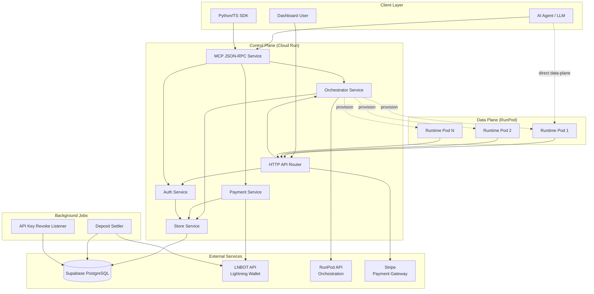
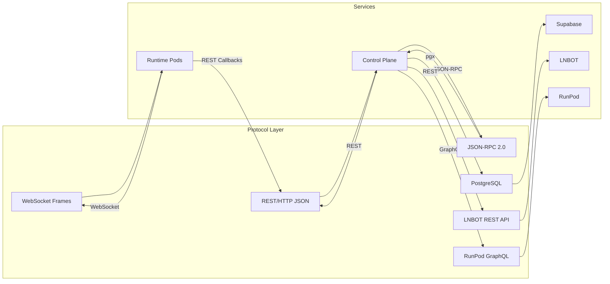
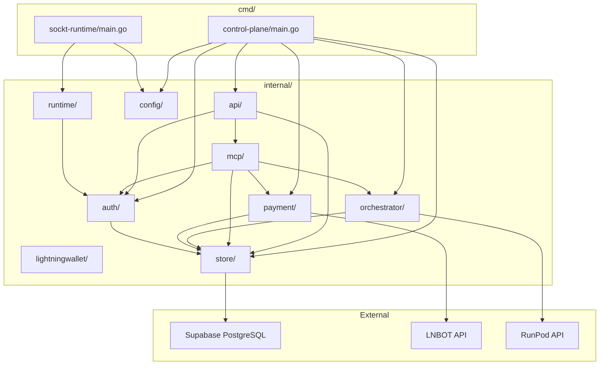
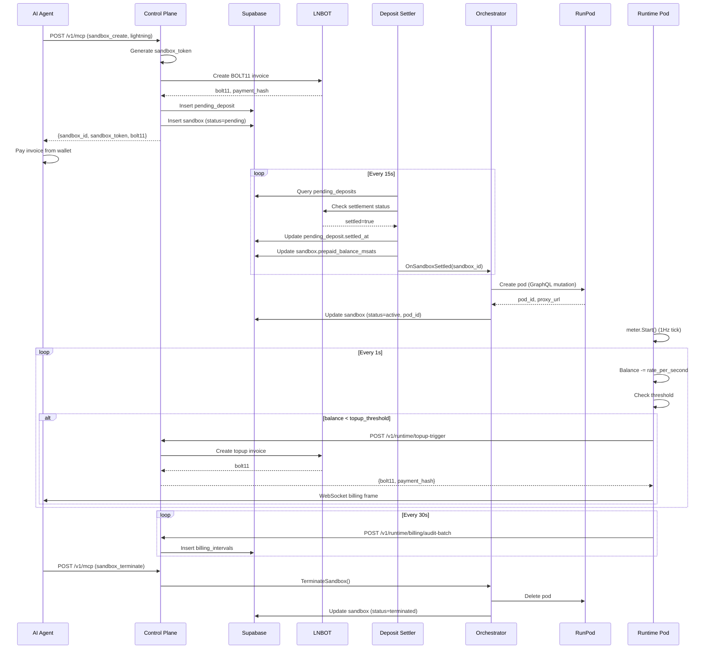
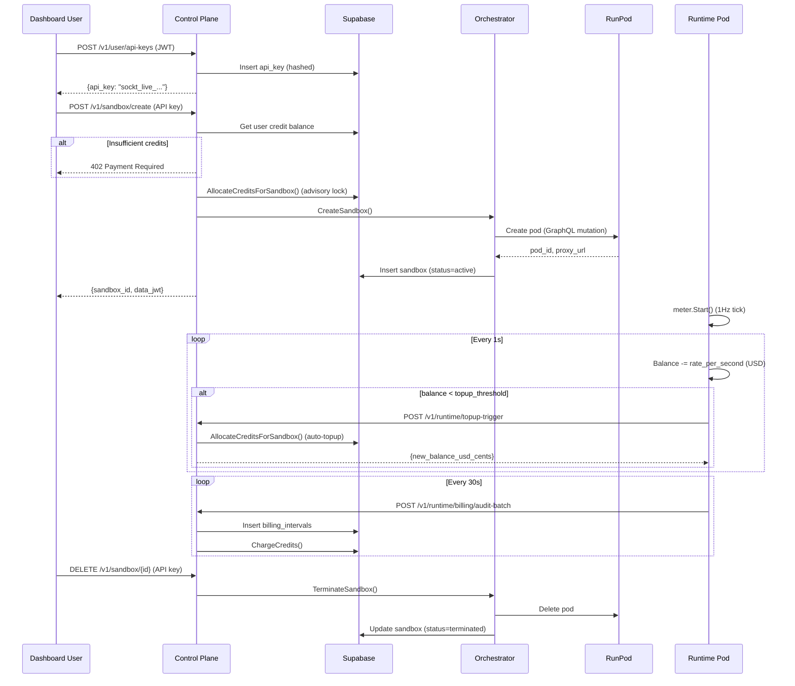

# Sockt Backend Architecture

## Overview

Sockt is a serverless compute platform that provides ephemeral sandbox environments for AI agents and LLMs. The system enables both traditional credit-based billing and anonymous Lightning Network prepaid access, orchestrating compute resources on RunPod infrastructure while maintaining financial isolation and security.

**Key Capabilities:**
- Multi-tier GPU/CPU sandbox provisioning (nano, micro, standard, gpu_small, gpu_large)
- Dual billing modes: credit-based (user accounts) and Lightning Network prepaid (anonymous agents)
- Model Context Protocol (MCP) JSON-RPC interface for AI agent integration
- Per-second billing with real-time metering and balance management
- WebSocket shell access with PTY support
- File operations (read, write, list) with path sandboxing

---

## System Architecture

### High-Level Architecture



### Two-Service Architecture

The system consists of two main Go services:

#### 1. **Control Plane** (`cmd/control-plane/`)
- **Deployment:** Google Cloud Run (serverless, auto-scaling)
- **Purpose:** User management, sandbox orchestration, billing, payments
- **Entry Point:** `/cmd/control-plane/main.go`
- **Port:** Configurable (default from `PORT` env var)
- **Key Responsibilities:**
  - User authentication (JWT, API keys, sandbox tokens)
  - Sandbox lifecycle orchestration (create, pause, resume, terminate)
  - Payment processing (Lightning invoices, Stripe webhooks)
  - MCP JSON-RPC tool dispatch
  - Runtime callback processing (metering, topups, pause triggers)

#### 2. **Runtime Service** (`cmd/sockt-runtime/`)
- **Deployment:** Per-pod on RunPod (one separate pod per sandbox)
- **Purpose:** In-sandbox execution, file operations, shell access
- **Entry Point:** `/cmd/sockt-runtime/main.go`
- **Port:** 8443 (proxied via RunPod)
- **Isolation:** Each sandbox runs in its own dedicated RunPod pod (VM/container)
- **Key Responsibilities:**
  - Command execution in sandboxed environment
  - File I/O (read, write, list) with path jailing
  - WebSocket PTY shell access
  - Per-second billing metering and callbacks to control plane
  - Balance monitoring and topup triggers

---

## Go Modules

### Module Structure

The project is organized into **10 internal packages** plus **2 command binaries**:

```
sockt-backend/
├── cmd/
│   ├── control-plane/     # Control plane entry point
│   └── sockt-runtime/     # Runtime data-plane entry point
├── internal/
│   ├── api/              # HTTP router and REST handlers
│   ├── auth/             # Authentication & authorization
│   ├── config/           # Environment configuration
│   ├── lightningwallet/  # Balance state helpers
│   ├── mcp/              # MCP JSON-RPC implementation
│   ├── orchestrator/     # RunPod orchestration
│   ├── payment/          # Lightning Network integration
│   ├── runtime/          # In-pod runtime handlers
│   └── store/            # PostgreSQL data access
├── supabase/
│   └── migrations/       # Database schema migrations
└── go.mod
```

### Module Dependencies

**Key Go Dependencies** (from `go.mod`):
- **PostgreSQL:** `github.com/jackc/pgx/v5` (v5.9.2) - Connection pooling, transactions
- **Lightning:** `github.com/lightningnetwork/lnd` (v0.19.3-beta) - BOLT11 decoding via zpay32
- **Bitcoin:** `github.com/btcsuite/btcd` (v0.24.3) - Bitcoin utilities, address handling
- **WebSocket:** `github.com/gorilla/websocket` (v1.5.0) - Shell and streaming
- **JWT:** `github.com/golang-jwt/jwt/v4` (v4.4.2) - Token verification
- **UUID:** `github.com/google/uuid` (v1.6.0) - Sandbox/user identifiers
- **Rate Limiting:** `golang.org/x/time` (v0.15.0) - Token bucket rate limiter
- **PTY:** `github.com/creack/pty` (v1.1.24) - Pseudo-terminal for shells
- **LRU Cache:** `github.com/hashicorp/golang-lru/v2` (v2.0.7) - API key caching

---

## Internal Module Details

### 1. **`internal/api`** - HTTP Router & Handlers
**Location:** `/internal/api/`

**Purpose:** Control plane HTTP surface - REST endpoints, middleware, response formatting

**Key Files:**
- `router.go` (110 lines) - HTTP mux setup with all route registrations
- `handlers.go` (397 lines) - User and sandbox REST handlers
- `runtime_handlers.go` (379 lines) - Runtime callback handlers
- `respond.go` (42 lines) - JSON/error response helpers
- `stripe.go` (138 lines) - Stripe webhook verification
- `wallet_lightning.go` (16 lines) - Lightning wallet URL helpers
- `smoke_test.go` - Router integration tests

**Routes Registered:**
| Route | Method | Auth | Purpose |
|-------|--------|------|---------|
| `/healthz` | GET | None | Health probe with dependency status |
| `/v1/pricing` | GET | None | Public tier pricing catalog |
| `/v1/mcp/health` | GET | None | MCP capability probe |
| `/v1/mcp` | GET | None | SSE endpoint discovery (legacy) |
| `/v1/mcp` | POST | Various | JSON-RPC 2.0 MCP tools |
| `/v1/user/profile` | GET | JWT | User dashboard information |
| `/v1/user/credits` | GET | JWT | Current credit balance |
| `/v1/user/credits/history` | GET | JWT | Credit transaction ledger |
| `/v1/user/api-keys` | POST | JWT | Issue new API key |
| `/v1/user/api-keys` | GET | JWT | List API keys |
| `/v1/user/api-keys/{id}` | DELETE | JWT | Revoke API key |
| `/v1/sandbox/create` | POST | API Key | Create sandbox (credits only) |
| `/v1/sandbox/{id}` | GET | API Key | Get sandbox details |
| `/v1/sandbox/{id}/pause` | POST | API Key | Pause workload |
| `/v1/sandbox/{id}/resume` | POST | API Key | Resume workload |
| `/v1/sandbox/{id}` | DELETE | API Key | Terminate sandbox |
| `/v1/sandbox/{id}/refresh-data-jwt` | POST | API Key | Mint fresh data JWT |
| `/v1/sandbox/{id}/extend-balance` | POST | API Key | Allocate additional credits |
| `/v1/sandbox/{id}/billing` | GET | API Key | Billing history |
| `/v1/runtime/billing/audit-batch` | POST | Callback Secret | Ingest metered billing |
| `/v1/runtime/topup-trigger` | POST | Callback Secret | Request balance topup |
| `/v1/runtime/pause-trigger` | POST | Callback Secret | Out-of-band pause |
| `/internal/webhooks/stripe` | POST | Stripe HMAC | Payment webhook |

**Middleware Chain:**
1. `recoverReqIDLog` - Panic recovery and request ID injection
2. Rate limiting - Shared 120 rpm across REST + MCP
3. Authentication - JWT / API key / Sandbox token / Callback secret
4. Authorization - Sandbox ownership checks

---

### 2. **`internal/auth`** - Authentication & Authorization
**Location:** `/internal/auth/`

**Purpose:** Multi-mode authentication, rate limiting, principal context

**Five Authentication Mechanisms:**

1. **User JWT** (`jwt.go`, 84 lines)
   - HS256 JWT issued by Supabase Auth
   - `sub` claim = user UUID
   - Used by `/v1/user/*` routes
   - Secret from `SUPABASE_JWT_SECRET`

2. **API Keys** (`apikey.go`, 142 lines)
   - Prefix: `sockt_live_...` (32 bytes base64)
   - Hashed storage (SHA-256)
   - LRU cache (10k capacity, configurable)
   - PostgreSQL LISTEN for real-time revocation
   - Used by REST `/v1/sandbox/*` and MCP POST

3. **Sandbox Tokens** (`sandboxtoken.go`, 59 lines)
   - Prefix: `sbx_...` (16 bytes crockford-base32)
   - Opaque bearer tokens for anonymous Lightning sandboxes
   - Bound to sandbox UUID + pod ID
   - Used by MCP POST for Lightning workflows

4. **Data JWT** (`data_jwt.go`, 46 lines)
   - HS256 JWT for runtime data-plane access
   - Scopes: `exec`, `files`, `shell`, `all`
   - Short-lived (configurable expiry)
   - Generated by control plane, validated by runtime

5. **Callback Secret** (`jwt.go`, `BearerSecret` middleware)
   - Static bearer token from `CALLBACK_SECRET` env var
   - Used by runtime pods for callbacks to control plane

**Rate Limiting** (`ratelimit.go`, 100 lines):
- Token bucket algorithm (via `golang.org/x/time/rate`)
- Default: 120 rpm per principal or IP
- Shared limit across REST + MCP POST
- Key extraction: `Principal.BalanceKey()` or `ip:<client_ip>`

**Principal Context** (`context.go`, 46 lines):
- Four principal kinds: `KindAPIKey`, `KindSandbox`, `KindL402`, `KindUserJWT`, `KindCallback`
- `BalanceKey()` for rate limit bucketing
- `UserID`, `SandboxID` accessors for authorization

---

### 3. **`internal/config`** - Configuration Management
**Location:** `/internal/config/`

**Purpose:** Load and validate configuration from environment variables

**Key Files:**
- `control.go` (315 lines) - Control plane configuration struct

**Configuration Categories:**

**Supabase / PostgreSQL:**
- `SUPABASE_URL` - Supabase project URL
- `SUPABASE_JWT_SECRET` - HS256 JWT verification secret
- `SUPABASE_DB_TX_DSN` - Transaction pool connection string
- `SUPABASE_DB_SESSION_DSN` - Session pool connection string

**RunPod:**
- `RUNPOD_API_KEY` - RunPod API authentication
- `RUNPOD_CPU_TEMPLATE_ID` - CPU sandbox template
- `RUNPOD_GPU_SMALL_TEMPLATE_ID` - Small GPU template
- `RUNPOD_GPU_LARGE_TEMPLATE_ID` - Large GPU template

**Lightning Network:**
- `LIGHTNING_NETWORK` - `mainnet` or `testnet`
- `LNBOT_API_BASE_URL` - LNBOT API endpoint
- `LNBOT_API_KEY` - LNBOT authentication (uk_... or wk_...)
- `LNBOT_WALLET_ID` - Default wallet UUID
- `LNBOT_HTTP_TIMEOUT` - HTTP client timeout

**MCP Settings:**
- `MCP_RPM` - Rate limit (requests per minute, default 300)
- `MCP_REQUEST_BODY_LIMIT_BYTES` - JSON-RPC body size limit (default 4MB)
- `MCP_PROXY_TIMEOUT_SECS` - Tool execution timeout (default 120s)
- `MCP_DATA_JWT_TTL_SECS` - Data JWT TTL for MCP proxying (0 = use DataJWTTTL)

**Sandbox Billing:**
- `SANDBOX_PREPAY_SECS` - How many seconds of compute one sandbox-scoped BOLT11 prepays (default 30, min 5)
- `SANDBOX_TOPUP_TRIGGER_SECS` - How few seconds of remaining balance triggers a top-up mint (default 5, min 1)
- `BALANCE_LOW_WATER_SECS` - Low water mark for balance warnings (default 60)
- `BALANCE_TOPUP_CHUNK_SECS` - Topup chunk size in seconds (default 300)

**Sandbox Readiness:**
- `SANDBOX_READY_TIMEOUT_SECS` - Max time to wait for runtime /healthz after pod create or resume (default 120s)
- `SANDBOX_READY_POLL_INTERVAL_MS` - Delay between readiness probes (default 750ms)
- `SANDBOX_READY_PROBE_TIMEOUT_SECS` - Per-request HTTP timeout for each GET /healthz (default 8s)

**Other:**
- `CALLBACK_SECRET` - Runtime callback authentication
- `STRIPE_WEBHOOK_SECRET` - Stripe HMAC verification
- `CONTROL_PLANE_PUBLIC_URL` - Public base URL for control plane
- `PORT` - HTTP listen port
- `LOG_LEVEL` - Logging verbosity (debug, info, error)

---

### 4. **`internal/store`** - PostgreSQL Data Access
**Location:** `/internal/store/`

**Purpose:** Database operations with dual connection pooling

**Key Files:**
- `store.go` (122 lines) - Store struct with Tx and Session pools
- `sandboxes.go` (205 lines) - Sandbox CRUD and billing
- `users.go` (156 lines) - User credit management
- `apikeys.go` (93 lines) - API key creation/revocation
- `agents.go` (114 lines) - Lightning agent rows
- `pricing.go` (38 lines) - Tier pricing queries
- `billing.go` (267 lines) - Billing intervals and audits
- `pools.go` (60 lines) - Connection pool setup

**Connection Pooling:**
- **Transaction Pool (`PoolTx`)**: Read-write operations, transactions
- **Session Pool (`PoolSession`)**: Advisory locks, LISTEN/NOTIFY
- Max connections: 50 per pool (configurable)
- Idle timeout: 5 minutes
- Connection lifetime: 1 hour

**Core Data Models:**

**User:**
```go
type User struct {
    ID                    uuid.UUID
    Email                 string
    CreditBalanceUSDCents int64
    WarningLevel          string
}
```

**Sandbox:**
```go
type Sandbox struct {
    ID                        uuid.UUID
    AgentID                   *uuid.UUID // For Lightning billing
    UserID                    *uuid.UUID // For credits billing
    APIKeyID                  *uuid.UUID // For credits billing
    BillingMethod             string     // credits or lightning
    Tier                      string     // nano, micro, standard, gpu_small, gpu_large
    Template                  string     // RunPod template identifier
    Status                    string     // pending, active, paused, terminating, terminated
    Runtime                   string     // runpod_cpu or runpod_gpu
    PodID                     *string    // RunPod pod ID
    PodProxyURL               *string    // https://{pod_id}-8443.proxy.runpod.net
    NetworkVolumeID           *string    // RunPod network volume ID
    ConsumedMsats             int64      // Total consumed (Lightning)
    SandboxToken              *string    // For anonymous Lightning billing
    PrepaidBalanceMsats       int64      // Lightning prepaid balance
    PendingInvoiceBolt11      *string    // Pending invoice
    PendingInvoicePaymentHash []byte     // Payment hash
    PendingInvoiceAmountMsats *int64     // Invoice amount
    PendingInvoiceExpiresAt   *time.Time // Invoice expiry
}
```

**Note:** The `allocated_usd_cents` and `charged_usd_cents` fields mentioned in some documentation do not exist in the actual database schema. Credit allocation and charging is tracked through the `credit_transactions` table instead.

**APIKey:**
```go
type APIKey struct {
    ID        uuid.UUID
    UserID    uuid.UUID
    KeyHash   string // SHA-256 hash
    KeyPrefix string // First chars for display
    Name      string
    IsActive  bool
}
```

**BillingInterval:**
```go
type BillingInterval struct {
    SandboxID uuid.UUID
    AgentID   uuid.UUID
    Start     interface{} // time
    End       interface{}
    Msats     int64
}
```

**Database Constraints:**
- Sandboxes must satisfy billing consistency:
  - Lightning: `billing_method = 'lightning' AND user_id IS NULL AND api_key_id IS NULL AND ((agent_id IS NOT NULL AND sandbox_token IS NULL) OR (agent_id IS NULL AND sandbox_token IS NOT NULL))`
  - Credits: `billing_method = 'credits' AND agent_id IS NULL AND user_id IS NOT NULL AND api_key_id IS NOT NULL AND sandbox_token IS NULL`
- Additional fields required: `template` and `runtime` (runpod_cpu or runpod_gpu)

---

### 5. **`internal/mcp`** - Model Context Protocol
**Location:** `/internal/mcp/`

**Purpose:** JSON-RPC 2.0 implementation of MCP for AI agent integration

**Key Files:**
- `service.go` (527 lines) - Tool dispatcher and business logic
- `proxy.go` (456 lines) - Runtime data-plane proxy
- `tools.go` (215 lines) - MCP tool schema definitions
- `handler.go` (181 lines) - HTTP POST handler
- `mcp.go` (256 lines) - JSON-RPC 2.0 protocol types
- `auth.go` (34 lines) - MCP-specific auth middleware

**JSON-RPC 2.0 Methods:**
- `initialize` - Handshake, returns capabilities, sets `Mcp-Session-Id`
- `tools/list` - Returns all 9 tool schemas
- `tools/call` - Executes named tool with arguments
- `ping` - Health check

**MCP Tools (9 total):**

1. **`sandbox_create`**
   - Creates new sandbox with credits or Lightning billing
   - Lightning flow: returns sandbox_id, sandbox_token, bolt11 invoice
   - Credits flow: immediate provisioning with allocated balance
   - Tiers: nano, micro, standard, gpu_small, gpu_large

2. **`sandbox_exec`**
   - Execute command in sandbox
   - Returns stdout, stderr, exit code
   - Auth: API key (credits) or sandbox token (Lightning)

3. **`sandbox_write_file`**
   - Write file content (base64 encoded for binary)
   - Path sandboxing enforced by runtime

4. **`sandbox_read_file`**
   - Read file content (base64 for binary)
   - Directory listing if path is directory

5. **`sandbox_list_files`**
   - List directory contents recursively
   - Returns file paths, sizes, modification times

6. **`sandbox_status`**
   - Get sandbox metrics and billing state
   - Returns: pod status, balance, consumed, tier, rate

7. **`sandbox_pause`**
   - Pause sandbox workload
   - Stops billing meter

8. **`sandbox_resume`**
   - Resume paused sandbox
   - Restarts billing meter

9. **`sandbox_terminate`**
   - Terminate sandbox permanently
   - Cleanup RunPod resources

**Authentication Modes:**
- **Anonymous:** Only `initialize`, `tools/list`, and `sandbox_create` (Lightning) allowed
- **API Key:** Full access to credit-based sandboxes
- **Sandbox Token:** Full access to specific Lightning sandbox

**Error Codes:**
- `-32001` - Authentication failed
- `-32002` - Payment required (insufficient credits/balance)
- `-32003` - Not found (sandbox, file, etc.)
- `-32005` - Rate limited
- `-32006` - Service unavailable (RunPod disabled)

---

### 6. **`internal/orchestrator`** - RunPod Orchestration
**Location:** `/internal/orchestrator/`

**Purpose:** RunPod API client and sandbox lifecycle management

**Key Files:**
- `orchestrator.go` (317 lines) - Service implementation
- `health.go` (114 lines) - Pod health checks
- `sandbox_env.go` (97 lines) - Environment variable injection

**RunPod Integration:**

**Architecture:** Each sandbox gets its own dedicated RunPod pod (separate VM/container instance). This is **one-to-one mapping** - NOT multiple containers in a single pod, but multiple independent pods.

**Tier Mapping:**
| Tier | Template | GPU | msats/s | usd_cents/s (x100) |
|------|----------|-----|---------|-------------------|
| nano | CPU | - | 1 | 1 |
| micro | CPU | - | 5 | 5 |
| standard | CPU | - | 20 | 20 |
| gpu_small | GPU | RTX 3070 | 100 | 100 |
| gpu_large | GPU | A100 | 400 | 400 |

**Note:** The pricing values above are placeholder rates from the initial migration. The `usd_cents_per_second_x100` field represents cents per second multiplied by 100 for precision. Production rates should be tuned based on actual RunPod costs.

**Pod Lifecycle Operations:**
1. **Create Pod:**
   - POST to RunPod REST API `/pods` (one new pod per sandbox)
   - Template ID from config (CPU vs GPU)
   - Unique pod name: `sockt-{sandbox_id[:8]}`
   - Environment injection (SANDBOX_ID, JWT_SECRET, etc.)
   - Returns unique pod_id and proxy URL: `https://{pod_id}-8443.proxy.runpod.net`

2. **Pause Pod:**
   - POST `/pods/{pod_id}/stop` (stops specific pod)
   - Pod compute paused, billing stops
   - State persisted in storage

3. **Resume Pod:**
   - POST `/pods/{pod_id}/start` (starts specific pod)
   - Pod compute resumes, billing resumes

4. **Terminate Pod:**
   - DELETE `/pods/{pod_id}` (deletes specific pod)
   - Update sandbox status to `terminated`

**Environment Variables Injected:**
- `SANDBOX_ID` - Sandbox UUID
- `JWT_SECRET` - HS256 secret for data JWT validation
- `CONTROL_PLANE_URL` - Control plane base URL for callbacks
- `CALLBACK_SECRET` - Bearer token for callback auth
- `SANDBOX_ROOT` - Sandboxed filesystem root path
- `BILLING_METHOD` - `credits` or `lightning`
- `PREPAID_BALANCE_MSATS` - Initial balance (Lightning)
- `TOPUP_THRESHOLD_MSATS` - Trigger topup threshold
- `SAFETY_FLOOR_MSATS` - Pause threshold
- `TIER` - Tier name (for rate calculation)

---

### 7. **`internal/payment`** - Lightning Network Integration
**Location:** `/internal/payment/`

**Purpose:** Lightning Network payment operations via LNBOT

**Key Files:**
- `payment.go` (247 lines) - Payment interface implementation
- `lnbot/client.go` (239 lines) - LNBOT REST API client
- `deposit.go` (182 lines) - Deposit invoice minting
- `deposits.go` (118 lines) - Background settlement polling
- `bolt11_decode.go` (34 lines) - BOLT11 parsing via btcsuite
- `idem.go` (80 lines) - Idempotency cache for invoice requests
- `errors.go` (80 lines) - Payment error classification
- `types.go` (29 lines) - Payment type definitions

**Payment Interface:**
```go
type Payment interface {
    PayInvoice(ctx context.Context, bolt11 string) (*PaymentResult, error)
    CreateBOLT11Invoice(ctx context.Context, req InvoiceRequest) (*Bolt11Invoice, error)
    RequestDepositInvoice(ctx context.Context, agentID, memo string, amtMsats int64) (*DepositMintResult, error)
    RequestSandboxDepositInvoice(ctx context.Context, sandboxID, memo string, amtMsats int64) (*DepositMintResult, error)
    GetNodeBalance(ctx context.Context) (int64, error)
    GetNodeHealth(ctx context.Context) (bool, error)
}
```

**LNBOT Client:**
- REST API client for wallet operations
- Authentication: Bearer token (uk_... for user keys, wk_... for wallet keys)
- Endpoints:
  - `POST /v1/wallets` - Create wallet
  - `POST /v1/invoices` - Create invoice
  - `GET /v1/invoices/{payment_hash}` - Check settlement
  - `POST /v1/payments` - Pay invoice
  - `GET /v1/wallets/{id}/balance` - Get balance

**Deposit Settlement Background Job:**
- Polls pending deposits every 15 seconds (configurable)
- Queries LNBOT for settlement status
- On settlement:
  - Credits sandbox/agent prepaid balance
  - Invokes `OnSandboxSettled` callback
  - Triggers pod provisioning if sandbox was pending

**Idempotency Cache:**
- LRU cache (1000 capacity) for invoice request deduplication
- Key: `(sandbox_id, memo, amount_msats)`
- TTL: 5 minutes
- Prevents duplicate invoice creation on retry

**Error Classification:**
- `ClassOfferInvalid` - Malformed BOLT11
- `ClassInvoiceExpired` - Past expiry time
- `ClassRoutingFailure` - Unable to route payment
- `ClassPaymentRejected` - Recipient declined
- `ClassOfferUnreachable` - Node offline
- `ClassLightningUnavailable` - LNBOT/LND unavailable

---

### 8. **`internal/runtime`** - In-Pod Runtime
**Location:** `/internal/runtime/`

**Purpose:** Data-plane operations, metering, and callbacks

**Key Files:**
- `config.go` (205 lines) - Runtime config from env vars
- `server.go` (76 lines) - HTTP mux setup
- `exec.go` (133 lines) - Command execution
- `files.go` (172 lines) - File I/O operations
- `shell.go` (263 lines) - WebSocket PTY shell
- `meter.go` (312 lines) - Billing metering and balance management
- `callbacks.go` (282 lines) - Control plane HTTP callbacks
- `status.go` (42 lines) - Pod status reporting
- `paths.go` (61 lines) - Path validation and jailing
- `auth.go` (107 lines) - Data JWT authentication middleware

**Runtime Endpoints:**
| Route | Method | Auth | Purpose |
|-------|--------|------|---------|
| `/sandbox/{id}/exec` | POST | Data JWT (exec) | Execute command |
| `/sandbox/{id}/files` | POST | Data JWT (files) | Write file |
| `/sandbox/{id}/files` | GET | Data JWT (files) | Read file |
| `/sandbox/{id}/files/list` | GET | Data JWT (files) | List directory |
| `/sandbox/{id}/status` | GET | Data JWT (exec) | Pod metrics |
| `/sandbox/{id}/shell` | GET (WS) | Data JWT (shell) | Interactive shell |

**Metering System (`meter.go`):**

**1Hz Tick Loop:**
```go
for {
    select {
    case <-ticker.C:
        // 1. Deduct balance at tier rate (per-second)
        m.Balance -= ratePerSecond
        
        // 2. Check topup threshold
        if m.Balance < cfg.TopupThreshold {
            m.triggerTopup() // POST to control plane
        }
        
        // 3. Check safety floor (pause)
        if m.Balance <= cfg.SafetyFloor {
            m.triggerPause() // POST to control plane
        }
        
        // 4. Record billing interval
        intervals = append(intervals, BillingInterval{...})
        
        // 5. Broadcast metrics to WebSocket subscribers
        m.broadcast(MeterEvent{Balance: m.Balance, ...})
    }
}
```

**Callback System (`callbacks.go`):**

**Audit Batch (Every 30 seconds):**
```http
POST /v1/runtime/billing/audit-batch
Authorization: Bearer {CALLBACK_SECRET}

{
  "sandbox_id": "...",
  "intervals": [
    {
      "started_at": "2026-05-11T12:00:00Z",
      "ended_at": "2026-05-11T12:00:01Z",
      "duration_ms": 1000,
      "consumed_msats": 2000,
      "balance_msats": 50000000,
      "tier": "standard"
    }
  ]
}
```

**Topup Trigger (On low balance):**
```http
POST /v1/runtime/topup-trigger
Authorization: Bearer {CALLBACK_SECRET}

{
  "sandbox_id": "...",
  "requested_msats": 100000000,
  "current_balance_msats": 5000000,
  "billing_method": "lightning"
}
```

**Response (Lightning):**
```json
{
  "ok": true,
  "bolt11": "lnbc...",
  "payment_hash": "...",
  "amount_msats": 100000000
}
```

**Response (Credits):**
```json
{
  "ok": true,
  "allocated_usd_cents": 100,
  "new_balance_msats": 105000000
}
```

**WebSocket Shell (`shell.go`):**

**Connection:**
```
GET /sandbox/{id}/shell?token={data_jwt}
Upgrade: websocket
```

**Client Frames:**
```json
{"type": "input", "data": "ls -la\n"}
{"type": "resize", "cols": 120, "rows": 40}
{"type": "ping"}
{"type": "request_topup"}
```

**Server Frames:**
```json
{"type": "stdout", "data": "total 48\ndrwxr-xr-x..."}
{"type": "stderr", "data": "error: file not found"}
{"type": "exit", "code": 0}
{"type": "billing", "balance": 50000000, "consumed": 12000000}
{"type": "deposit_required", "bolt11": "lnbc...", "amount_msats": 100000000}
```

---

### 9. **`internal/lightningwallet`** - Balance State Helpers
**Location:** `/internal/lightningwallet/`

**Purpose:** Lightning prepaid balance UX helpers

**Key Files:**
- `hints.go` (44 lines) - Balance state to next-action mapping

**Balance States:**
```go
const (
    StateOK                = "ok"                 // Sufficient balance
    StateDepositRequired   = "deposit_required"   // Below low-water mark
    StateOutOfBalance      = "out_of_balance"     // Zero or negative
)
```

**Hint Generation:**
- Input: Current balance, threshold, safety floor
- Output: State string + suggested action
- Used by MCP tools and WebSocket billing frames

---

## Component Communication

### Communication Protocols



### Service Interaction Patterns

#### **Synchronous (Request-Response)**

**1. MCP Tool Call Flow:**
```
Client → POST /v1/mcp (JSON-RPC)
  ↓
MCP Service → Authenticate (API key/sandbox token)
  ↓
MCP Service → Rate Limit Check
  ↓
MCP Service → Tool Dispatch (sandbox_exec)
  ↓
MCP Service → Store Query (get sandbox)
  ↓
MCP Service → Runtime Proxy (POST /sandbox/{id}/exec)
  ↓
Runtime → Execute Command
  ↓
Runtime → Return Output
  ↓
MCP Service → Format JSON-RPC Response
  ↓
Client ← 200 OK {"jsonrpc": "2.0", "result": {...}}
```

**2. Sandbox Creation (Credits):**
```
Client → POST /v1/sandbox/create
  ↓
API Handler → Authenticate (API key)
  ↓
API Handler → Store Query (user credit balance)
  ↓
API Handler → Allocate Credits (advisory lock)
  ↓
API Handler → Orchestrator.CreateSandbox()
  ↓
Orchestrator → RunPod API (create pod mutation)
  ↓
Orchestrator → Store Insert (sandbox record)
  ↓
Client ← 200 OK {sandbox details, data_jwt}
```

**3. Sandbox Creation (Lightning):**
```
Client → POST /v1/mcp {"method": "tools/call", "params": {"name": "sandbox_create", ...}}
  ↓
MCP Service → Generate sandbox_token (16 bytes)
  ↓
MCP Service → Payment.RequestSandboxDepositInvoice()
  ↓
Payment → LNBOT API (create invoice)
  ↓
Payment → Store Insert (pending_deposits)
  ↓
Payment → Store Insert (sandbox, status=pending)
  ↓
Client ← 200 OK {"result": {"sandbox_id": "...", "sandbox_token": "sbx_...", "bolt11": "...", "payment_hash": "..."}}
```

#### **Asynchronous (Background Jobs)**

**1. Deposit Settlement:**
```
DepositSettlerBackground (every 15s):
  ↓
Query pending_deposits WHERE settled_at IS NULL
  ↓
For each pending:
  ↓
  LNBOT API → GET /v1/invoices/{payment_hash}
    ↓
    If settled:
      ↓
      Store Update (pending_deposits.settled_at = now)
      ↓
      Store Update (sandbox.prepaid_balance_msats += amount)
      ↓
      Callback: OnSandboxSettled(sandbox_id)
        ↓
        Orchestrator.CreateSandbox() (provision RunPod)
```

**2. API Key Revocation Listener:**
```
PostgreSQL NOTIFY apikey_revoked:
  ↓
auth.StartRevokedListener receives notification
  ↓
Parse notification payload (api_key_id)
  ↓
APIKeyCache.Purge(api_key_id)
  ↓
Future requests will re-query database
```

**3. Runtime Metering (1Hz):**
```
Meter.Start() tick loop:
  ↓
Every 1 second:
  ↓
  Deduct balance (rate_per_second)
  ↓
  Check threshold:
    ↓
    If balance < topup_threshold:
      ↓
      Callbacks.TriggerTopup() → POST /v1/runtime/topup-trigger
        ↓
        Control plane allocates credits OR mints Lightning invoice
        ↓
        Response: new balance OR bolt11 for user to pay
    ↓
    If balance <= safety_floor:
      ↓
      Callbacks.TriggerPause() → POST /v1/runtime/pause-trigger
        ↓
        Control plane calls Orchestrator.PauseSandbox()
  ↓
Every 30 seconds:
  ↓
  Callbacks.SendAuditBatch() → POST /v1/runtime/billing/audit-batch
    ↓
    Control plane records billing intervals in database
```

### Connection Details

#### **REST API (Control Plane ← Runtime)**
- **Protocol:** HTTP/1.1 JSON
- **Direction:** Runtime → Control Plane (callbacks)
- **Authentication:** Bearer token (CALLBACK_SECRET)
- **Retry:** 6 attempts with exponential backoff (100ms → 3.2s)
- **Timeout:** 10 seconds per request

#### **REST API (Control Plane → RunPod)**
- **Protocol:** GraphQL over HTTPS
- **Authentication:** Bearer token (RUNPOD_API_KEY)
- **Endpoint:** `https://api.runpod.io/graphql`
- **Operations:** Create pod, pause, resume, terminate

#### **REST API (Control Plane → LNBOT)**
- **Protocol:** HTTP/1.1 JSON
- **Authentication:** Bearer token (uk_... or wk_...)
- **Base URL:** Configurable (mainnet/testnet)
- **Timeout:** Configurable (default 30s)

#### **PostgreSQL (Control Plane → Supabase)**
- **Protocol:** PostgreSQL wire protocol (pgx)
- **Connection Pooling:** Dual pools (Tx + Session)
- **Max Connections:** 50 per pool
- **Idle Timeout:** 5 minutes
- **Connection Lifetime:** 1 hour

#### **WebSocket (Client → Runtime)**
- **Protocol:** WebSocket (RFC 6455)
- **Endpoint:** `GET /sandbox/{id}/shell?token={jwt}`
- **Authentication:** Data JWT in query param
- **Origin Validation:** Control plane URL + pod proxy URL
- **Concurrency Limit:** Configurable (default 10 shells per pod)

#### **Server-Sent Events (Client → Control Plane)**
- **Protocol:** SSE (text/event-stream)
- **Endpoint:** `GET /v1/mcp`
- **Purpose:** Legacy MCP discovery (POST URL + ping heartbeat)
- **Status:** Deprecated in favor of direct POST

---

## System Architecture Diagrams

### Component Dependency Graph



### Data Flow: Lightning Sandbox Lifecycle



### Data Flow: Credits Sandbox Lifecycle



---

## User Flows

### Flow 1: Dashboard User - Credit-Based Sandbox

**Actors:** Dashboard user, Supabase Auth, Control Plane, RunPod

**Steps:**

1. **Authentication:**
   - User signs up via Supabase Auth (OAuth, email/password)
   - Receives JWT token (HS256, sub = user_id)
   - JWT used for dashboard API calls

2. **API Key Creation:**
   - `POST /v1/user/api-keys` (JWT auth)
   - Control plane generates 32-byte random key
   - Hashes with SHA-256, stores in database
   - Returns plaintext key: `sockt_live_...` (only shown once)

3. **Credit Top-Up:**
   - User initiates Stripe payment (external flow)
   - Stripe webhook → `POST /internal/webhooks/stripe`
   - Control plane credits `users.credit_balance_usd_cents`

4. **Sandbox Creation:**
   - `POST /v1/sandbox/create` with API key
   - Body: `{"tier": "standard", "billing_method": "credits"}`
   - Control plane checks credit balance
   - Allocates credits (e.g., $10) to sandbox
   - Orchestrator provisions RunPod pod
   - Returns sandbox_id and data_jwt

5. **Sandbox Usage:**
   - Client calls runtime data-plane APIs with data_jwt
   - `POST /sandbox/{id}/exec` - Run commands
   - `GET /sandbox/{id}/files?path=/app/data.txt` - Read files
   - `POST /sandbox/{id}/files` - Write files
   - `GET /sandbox/{id}/shell` (WebSocket) - Interactive shell

6. **Billing:**
   - Runtime meter deducts balance every second
   - Auto-topup when balance < threshold
   - Control plane charges user credits
   - User sees charges in `GET /v1/user/credits/history`

7. **Termination:**
   - `DELETE /v1/sandbox/{id}` or auto-pause on zero balance
   - RunPod pod deleted
   - Remaining allocated credits returned to user

---

### Flow 2: AI Agent - Lightning Prepaid Sandbox

**Actors:** AI Agent (LLM), Control Plane, LNBOT, Lightning Wallet, RunPod

**Steps:**

1. **Anonymous Sandbox Creation:**
   - Agent calls `POST /v1/mcp` (no auth header)
   - JSON-RPC: `tools/call sandbox_create` with `billing_method=lightning`
   - Body: `{"tier": "gpu_small", "prepay_msats": 100000000}`

2. **Invoice Minting:**
   - Control plane generates sandbox_token (`sbx_...`)
   - Creates BOLT11 invoice via LNBOT
   - Returns: `{sandbox_id, sandbox_token, bolt11, payment_hash}`
   - Sandbox status = `pending`

3. **Payment:**
   - Agent pays BOLT11 invoice from Lightning wallet
   - Payment settles on Lightning Network

4. **Settlement Detection:**
   - Deposit settler background job polls LNBOT
   - Detects settled invoice
   - Credits sandbox prepaid balance
   - Triggers pod provisioning

5. **Pod Provisioning:**
   - Orchestrator creates RunPod pod
   - Injects environment: SANDBOX_ID, prepaid_balance_msats, etc.
   - Runtime starts metering (1Hz tick)
   - Sandbox status = `active`

6. **Sandbox Operations:**
   - Agent calls MCP tools with sandbox_token:
     - `sandbox_exec` - Run commands
     - `sandbox_write_file` - Upload code
     - `sandbox_read_file` - Retrieve results
     - `sandbox_status` - Check balance

7. **Balance Management:**
   - Runtime deducts balance every second (msats)
   - When balance < topup_threshold:
     - Runtime calls `POST /v1/runtime/topup-trigger`
     - Control plane mints new BOLT11 invoice
     - Returns invoice to runtime
     - Runtime sends WebSocket frame to agent
     - Agent pays invoice
     - Deposit settler credits balance

8. **Termination:**
   - Agent calls `sandbox_terminate` or balance reaches zero
   - Runtime pauses (if zero balance)
   - Agent can pay topup invoice to resume
   - Or call terminate to cleanup

---

### Flow 3: SDK Client - Python/TypeScript

**Actors:** SDK Client (Python/TS), Control Plane, Runtime Pod

**Steps:**

1. **SDK Initialization:**
   ```python
   from sockt import ComputeClient
   
   client = ComputeClient(
       api_key="sockt_live_...",  # Credits
       # OR
       billing_method="lightning"  # Lightning
   )
   ```

2. **Sandbox Creation:**
   ```python
   sandbox = client.create_sandbox(tier="standard")
   # Credits: immediate provisioning
   # Lightning: returns bolt11, waits for settlement
   ```

3. **Command Execution:**
   ```python
   result = sandbox.exec("python script.py")
   print(result.stdout)
   print(result.stderr)
   print(result.exit_code)
   ```

4. **File Operations:**
   ```python
   # Write
   sandbox.write_file("/app/data.txt", "Hello, World!")
   
   # Read
   content = sandbox.read_file("/app/data.txt")
   
   # List
   files = sandbox.list_files("/app")
   ```

5. **Shell Access:**
   ```python
   shell = sandbox.shell()
   
   @shell.on("stdout")
   def on_output(data):
       print(data, end="")
   
   @shell.on("billing")
   def on_billing(event):
       print(f"Balance: {event.balance} msats")
   
   shell.send("ls -la\n")
   shell.resize(cols=120, rows=40)
   ```

6. **Balance Monitoring:**
   ```python
   status = sandbox.status()
   print(f"Balance: {status.prepaid_balance_msats}")
   print(f"Consumed: {status.consumed_msats}")
   print(f"Rate: {status.rate_msats_per_second}")
   
   # Wallet operations (Lightning)
   deposit = sandbox.wallet_deposit(amount_msats=100000000)
   print(f"Pay invoice: {deposit.bolt11}")
   
   balance = sandbox.get_wallet_balance()
   ```

7. **Cleanup:**
   ```python
   sandbox.terminate()
   ```

---

## Database Schema

### Core Tables

**users:**
```sql
CREATE TABLE users (
    id UUID PRIMARY KEY REFERENCES auth.users(id) ON DELETE CASCADE,
    email TEXT UNIQUE NOT NULL,
    credit_balance_usd_cents BIGINT DEFAULT 0 CHECK (credit_balance_usd_cents >= 0),
    warning_level TEXT DEFAULT 'ok',
    created_at TIMESTAMPTZ DEFAULT NOW()
);
```

**api_keys:**
```sql
CREATE TABLE api_keys (
    id UUID PRIMARY KEY DEFAULT gen_random_uuid(),
    user_id UUID NOT NULL REFERENCES users(id) ON DELETE CASCADE,
    key_hash TEXT NOT NULL UNIQUE,
    key_prefix TEXT NOT NULL,
    name TEXT NOT NULL,
    is_active BOOLEAN DEFAULT TRUE,
    created_at TIMESTAMPTZ DEFAULT NOW()
);

CREATE INDEX idx_api_keys_user_id ON api_keys(user_id);
CREATE INDEX idx_api_keys_is_active ON api_keys(is_active);
```

**agents:**
```sql
CREATE TABLE agents (
    id UUID PRIMARY KEY DEFAULT gen_random_uuid(),
    jwt_sub UUID,  -- nullable for MCP anonymous agents
    prepaid_balance_msats BIGINT DEFAULT 0,
    warning_level TEXT DEFAULT 'ok',
    created_at TIMESTAMPTZ DEFAULT NOW()
);
```

**sandboxes:**
```sql
CREATE TABLE sandboxes (
    id UUID PRIMARY KEY DEFAULT gen_random_uuid(),
    agent_id UUID REFERENCES agents(id) ON DELETE RESTRICT,
    user_id UUID REFERENCES users(id) ON DELETE CASCADE,
    api_key_id UUID REFERENCES api_keys(id) ON DELETE CASCADE,
    billing_method TEXT NOT NULL CHECK (billing_method IN ('lightning', 'credits')),
    tier TEXT NOT NULL,
    template TEXT NOT NULL,
    status TEXT NOT NULL,
    runtime TEXT NOT NULL CHECK (runtime IN ('runpod_cpu', 'runpod_gpu')),
    pod_id TEXT,
    pod_proxy_url TEXT,
    network_volume_id TEXT,
    consumed_msats BIGINT DEFAULT 0,
    sandbox_token TEXT,
    prepaid_balance_msats BIGINT DEFAULT 0 CHECK (prepaid_balance_msats >= -1000000),
    pending_invoice_bolt11 TEXT,
    pending_invoice_payment_hash BYTEA,
    pending_invoice_amount_msats BIGINT,
    pending_invoice_expires_at TIMESTAMPTZ,
    created_at TIMESTAMPTZ DEFAULT NOW(),
    terminated_at TIMESTAMPTZ,
    
    CONSTRAINT billing_consistency CHECK (
        (billing_method = 'lightning' AND user_id IS NULL AND api_key_id IS NULL 
         AND ((agent_id IS NOT NULL AND sandbox_token IS NULL) 
              OR (agent_id IS NULL AND sandbox_token IS NOT NULL)))
        OR
        (billing_method = 'credits' AND agent_id IS NULL AND user_id IS NOT NULL 
         AND api_key_id IS NOT NULL AND sandbox_token IS NULL)
    )
);

CREATE INDEX idx_sandboxes_user_id ON sandboxes(user_id);
CREATE INDEX idx_sandboxes_agent_id ON sandboxes(agent_id);
CREATE INDEX idx_sandboxes_api_key_id ON sandboxes(api_key_id);
CREATE UNIQUE INDEX idx_sandboxes_sandbox_token ON sandboxes(sandbox_token) WHERE sandbox_token IS NOT NULL;
CREATE INDEX idx_sandboxes_pending_invoice_payment_hash ON sandboxes(pending_invoice_payment_hash) 
    WHERE pending_invoice_payment_hash IS NOT NULL;
```

**tier_pricing:**
```sql
CREATE TABLE tier_pricing (
    tier TEXT PRIMARY KEY,
    msats_per_second BIGINT NOT NULL,
    usd_cents_per_second_x100 BIGINT NOT NULL,
    updated_at TIMESTAMPTZ DEFAULT NOW()
);

-- Placeholder rates from MVP migration; tune for production
INSERT INTO tier_pricing VALUES
    ('nano', 1, 1),
    ('micro', 5, 5),
    ('standard', 20, 20),
    ('gpu_small', 100, 100),
    ('gpu_large', 400, 400);
```

**templates:**
```sql
CREATE TABLE templates (
    id UUID PRIMARY KEY DEFAULT gen_random_uuid(),
    name TEXT NOT NULL UNIQUE,
    runpod_template_id TEXT NOT NULL,
    runtime TEXT NOT NULL CHECK (runtime IN ('runpod_cpu', 'runpod_gpu')),
    default_tier TEXT NOT NULL REFERENCES tier_pricing(tier) ON UPDATE CASCADE ON DELETE RESTRICT,
    created_at TIMESTAMPTZ DEFAULT NOW()
);
```

**billing_intervals:**
```sql
CREATE TABLE billing_intervals (
    id UUID PRIMARY KEY DEFAULT gen_random_uuid(),
    sandbox_id UUID NOT NULL REFERENCES sandboxes(id) ON DELETE CASCADE,
    agent_id UUID NOT NULL REFERENCES agents(id) ON DELETE RESTRICT,
    interval_start TIMESTAMPTZ NOT NULL,
    interval_end TIMESTAMPTZ NOT NULL,
    msats_consumed BIGINT NOT NULL,
    created_at TIMESTAMPTZ DEFAULT NOW()
);

CREATE INDEX idx_billing_intervals_sandbox_created ON billing_intervals(sandbox_id, created_at DESC);
CREATE INDEX idx_billing_intervals_agent ON billing_intervals(agent_id);
```

**pending_deposits:**
```sql
CREATE TABLE pending_deposits (
    id UUID PRIMARY KEY DEFAULT gen_random_uuid(),
    agent_id UUID REFERENCES agents(id) ON DELETE RESTRICT,
    sandbox_id UUID REFERENCES sandboxes(id) ON DELETE CASCADE,
    payment_hash BYTEA NOT NULL UNIQUE,
    bolt11_invoice TEXT NOT NULL,
    amount_msats BIGINT NOT NULL,
    status TEXT DEFAULT 'pending',
    created_at TIMESTAMPTZ DEFAULT NOW(),
    settled_at TIMESTAMPTZ,
    
    CONSTRAINT pending_deposits_owner_check CHECK (
        (agent_id IS NOT NULL AND sandbox_id IS NULL)
        OR (agent_id IS NULL AND sandbox_id IS NOT NULL)
    )
);

CREATE INDEX idx_pending_deposits_agent ON pending_deposits(agent_id);
CREATE INDEX idx_pending_deposits_sandbox ON pending_deposits(sandbox_id) WHERE sandbox_id IS NOT NULL;
```

**credit_transactions:**
```sql
CREATE TABLE credit_transactions (
    id UUID PRIMARY KEY DEFAULT gen_random_uuid(),
    user_id UUID NOT NULL REFERENCES users(id) ON DELETE CASCADE,
    sandbox_id UUID REFERENCES sandboxes(id) ON DELETE SET NULL,
    type TEXT NOT NULL,
    amount_usd_cents BIGINT NOT NULL CHECK (amount_usd_cents > 0),
    balance_after_usd_cents BIGINT NOT NULL,
    description TEXT NOT NULL,
    stripe_payment_intent_id TEXT,
    created_at TIMESTAMPTZ DEFAULT NOW()
);

CREATE INDEX idx_credit_tx_user_created ON credit_transactions(user_id, created_at DESC);
CREATE INDEX idx_credit_tx_type ON credit_transactions(type);
```

---

## Security Considerations

### Authentication Security

1. **API Key Storage:**
   - SHA-256 hashing before storage
   - No plaintext keys in database
   - LRU cache with TTL and revocation listener
   - Prefix validation (`sockt_live_`, `sbx_`)

2. **JWT Security:**
   - HS256 algorithm (HMAC with SHA-256)
   - Secret rotation via environment variables
   - Short-lived data JWTs (configurable expiry)
   - Scope enforcement (exec, files, shell, all)

3. **Sandbox Token Security:**
   - 16-byte cryptographically random generation
   - Crockford base32 encoding (URL-safe)
   - Bound to sandbox_id + pod_id
   - Single-use for anonymous Lightning flows

4. **Rate Limiting:**
   - Per-principal token bucket (120 rpm default)
   - Shared limit across REST + MCP
   - IP-based limiting for anonymous requests
   - Burst allowance for bursty workloads

### Data Plane Security

1. **Path Sandboxing:**
   - All file operations validated against `SANDBOX_ROOT`
   - Path traversal prevention (`..` filtering)
   - Symlink resolution before validation

2. **Command Execution:**
   - Subprocess isolation (no shell=True in Python)
   - Environment variable injection (controlled)
   - Resource limits (CPU, memory, disk) via RunPod

3. **WebSocket Security:**
   - Origin validation (control plane + pod proxy URLs)
   - JWT authentication in query parameter
   - Concurrency limiting (max shells per pod)
   - Frame size limits

### Financial Security

1. **Lightning Payment Verification:**
   - BOLT11 invoice parsing and validation
   - Payment hash uniqueness checks
   - Settlement confirmation before balance credit
   - Idempotency for invoice minting

2. **Credit Balance Management:**
   - PostgreSQL advisory locks for concurrent allocations
   - Atomic balance updates (CAS operations)
   - Transaction isolation (READ COMMITTED)
   - Audit trail (credit_transactions table)

3. **Metering Integrity:**
   - Callback secret authentication (bearer token)
   - Timestamp validation (prevent replay)
   - Idempotency keys for audit batches
   - Reconciliation between meter and database

---

## Operational Characteristics

### Scalability

**Control Plane (Cloud Run):**
- Auto-scaling based on request volume
- Stateless design (horizontal scaling)
- Connection pooling for PostgreSQL (max 50 per pool)
- LRU caching for API keys (10k capacity)

**Runtime Pods (RunPod):**
- **One dedicated pod per sandbox** (horizontal scaling model)
- Each pod is an independent VM/container instance on RunPod infrastructure
- Resource limits per tier (CPU, memory, GPU)
- No shared state between pods - complete isolation
- Each pod gets unique proxy URL: `https://{pod_id}-8443.proxy.runpod.net`
- Cleanup on termination

**Database (Supabase PostgreSQL):**
- Managed service with replication
- Connection pooling (pgx pools)
- Read replica support (future)
- Index optimization for hot queries

### Monitoring & Observability

**Logging:**
- Structured logging with `log/slog` (Go)
- Log levels: debug, info, error
- Request ID tracking (`X-Request-ID` header)
- Error context preservation

**Metrics:**
- Billing interval records (per-second granularity)
- Credit transaction history
- API key usage patterns
- Rate limit violations

**Health Checks:**
- `/healthz` endpoint with dependency status
- PostgreSQL connection health
- Lightning node connectivity
- RunPod API reachability

### Error Handling

**Retry Strategies:**
- Runtime callbacks: 6 attempts, exponential backoff (100ms → 3.2s)
- LNBOT API: Configurable timeout (default 30s)
- RunPod API: Client-side timeout and retry

**Graceful Degradation:**
- Lightning unavailable → credits-only mode
- RunPod unavailable → 503 Service Unavailable
- Database unavailable → 500 Internal Server Error

**Circuit Breakers:**
- Rate limiting (429 Too Many Requests)
- Concurrency limits (shell sessions)
- Balance floor enforcement (pause sandbox)

---

## Future Enhancements

### Planned Features

1. **Multi-Region Support:**
   - Deploy control plane to multiple regions
   - RunPod pod placement by geography
   - Latency-based routing

2. **Enhanced MCP Features:**
   - SSE streaming for long-running operations
   - Tool output streaming (stdout chunks)
   - Multi-turn conversation context

3. **Advanced Billing:**
   - Usage-based pricing tiers (volume discounts)
   - Reserved capacity pricing
   - Credit expiration policies

4. **Security Enhancements:**
   - mTLS for runtime ↔ control plane
   - API key rotation policies
   - Audit log retention and export

5. **Developer Experience:**
   - Web-based sandbox console
   - Real-time log streaming
   - Snapshot and restore functionality

---

## Glossary

- **Control Plane:** Central orchestration service managing users, sandboxes, and billing
- **Data Plane:** Per-sandbox runtime service handling execution, files, and shell
- **MCP (Model Context Protocol):** JSON-RPC 2.0 interface for AI agent integration
- **LNBOT:** Lightning Network wallet API for invoice creation and settlement
- **RunPod:** GPU/CPU infrastructure provider for sandbox provisioning (VM/container hosting)
- **Pod:** A single RunPod VM/container instance - each sandbox gets its own dedicated pod
- **Sandbox:** Isolated compute environment running in a dedicated RunPod pod (1:1 mapping)
- **Tier:** Resource allocation level (nano, micro, standard, gpu_small, gpu_large)
- **Prepaid Balance:** Lightning Network msats balance for sandbox usage
- **Allocated Credits:** USD cents reserved for sandbox usage (credit billing)
- **Meter:** Per-second billing tracker in runtime pods
- **Topup Threshold:** Balance level triggering automatic topup request
- **Safety Floor:** Balance level triggering sandbox pause
- **Sandbox Token:** Opaque bearer token for anonymous Lightning sandbox access
- **Data JWT:** Short-lived JWT for data-plane API authentication
- **Callback Secret:** Static bearer token for runtime → control plane callbacks
- **Deposit Settler:** Background job polling for Lightning invoice settlement
- **Advisory Lock:** PostgreSQL lock for serializing concurrent credit allocations

---

## References

**API Documentation:**
- [API_REFERENCE.md](/home/ali/development/Sockt/sockt-backend/API_REFERENCE.md) - Complete HTTP API specification

**Source Code:**
- Control Plane: `/cmd/control-plane/main.go`
- Runtime: `/cmd/sockt-runtime/main.go`
- HTTP Router: `/internal/api/router.go`
- MCP Service: `/internal/mcp/service.go`
- Payment Service: `/internal/payment/payment.go`
- Store: `/internal/store/store.go`

**External APIs:**
- [RunPod API](https://graphql-spec.runpod.io/) - Pod orchestration
- [LNBOT API](https://lnbot.example.com) - Lightning wallet operations
- [Supabase](https://supabase.com/docs) - PostgreSQL and Auth

**Standards:**
- [JSON-RPC 2.0](https://www.jsonrpc.org/specification)
- [Model Context Protocol](https://spec.modelcontextprotocol.io/)
- [BOLT #11 Lightning Invoices](https://github.com/lightning/bolts/blob/master/11-payment-encoding.md)
- [WebSocket RFC 6455](https://datatracker.ietf.org/doc/html/rfc6455)

---

## Document Revision History

**Last Verified:** 2026-05-11

**Major Corrections Applied:**

1. **Configuration Variables (Section 3):**
   - Fixed environment variable names to match actual implementation
   - Changed `SANDBOX_PREPAY_MSATS` → `SANDBOX_PREPAY_SECS`
   - Changed `SANDBOX_TOPUP_THRESHOLD` → `SANDBOX_TOPUP_TRIGGER_SECS`
   - Changed `MCP_TIMEOUT` → `MCP_PROXY_TIMEOUT_SECS`
   - Changed `MCP_MAX_BODY_BYTES` → `MCP_REQUEST_BODY_LIMIT_BYTES`
   - Added missing config: `SANDBOX_READY_TIMEOUT_SECS`, `SANDBOX_READY_POLL_INTERVAL_MS`, `SANDBOX_READY_PROBE_TIMEOUT_SECS`

2. **Database Schema:**
   - Added `template` and `runtime` fields to sandboxes table (required fields in actual schema)
   - Added `network_volume_id` field to sandboxes
   - Removed non-existent `allocated_usd_cents` and `charged_usd_cents` from Sandbox struct
   - Removed non-existent `updated_at` fields from users and sandboxes tables
   - Updated billing consistency constraints to match actual implementation
   - Added `templates` table documentation

3. **Tier Pricing:**
   - Corrected pricing values (were off by 100x in original documentation)
   - Actual values: nano=1, micro=5, standard=20, gpu_small=100, gpu_large=400
   - Added note that these are placeholder rates from migration

4. **File Line Counts:**
   - Updated all module file line counts to match actual codebase
   - Most significant changes: stripe.go (87→138), auth.go/mcp (105→34), status.go (134→42)

5. **Data Structures:**
   - Updated User, Sandbox, APIKey, BillingInterval structs to match actual Go code
   - Changed types from string to uuid.UUID where appropriate
   - Added pending invoice fields to Sandbox struct

6. **Authentication:**
   - Clarified that KindL402 is still present in codebase (not fully deprecated)
   - Listed all principal kinds: KindAPIKey, KindSandbox, KindL402, KindUserJWT, KindCallback

7. **Module Files:**
   - Added missing `wallet_lightning.go` and `smoke_test.go` to api module listing
   - Added `auth.go` to runtime module listing
   - Added `types.go` to payment module listing
