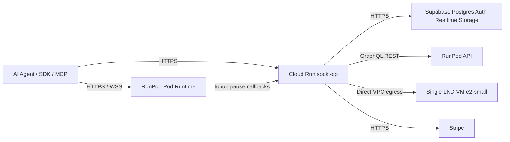
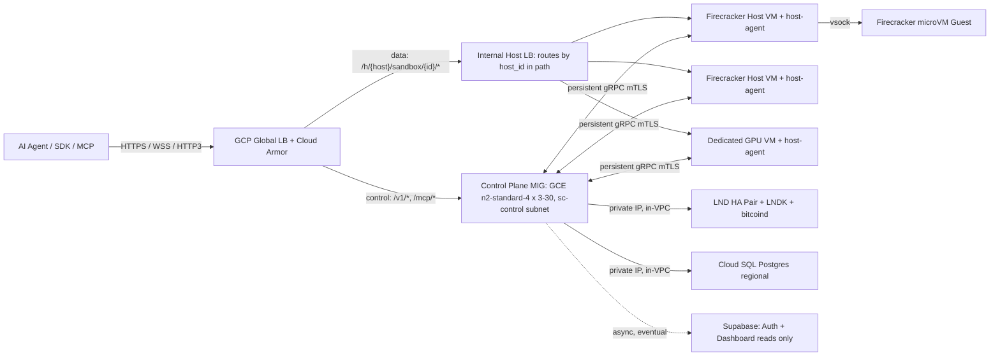

# Sockt — System Component Plans Index (MVP v3)

## v3 changelog

- Control plane moved to Cloud Run (`sockt-cp`) with min instances set to 0.
- Firecracker host pool, host-agent gRPC fabric, and consistent-hash cluster were removed for MVP.
- Sandbox runtime moved to RunPod pods for both CPU and GPU tiers.
- Cloud SQL was removed from MVP; Supabase Postgres is now the only database.
- Global LB + Cloud Armor + internal LBs were removed; Cloud Run domain mapping is used initially.
- LND HA pair was replaced with a single LND node on a small GCE VM (Neutrino mode).
- Billing meter moved into each runtime pod so control plane can scale to zero.
- Lightning agent funding ships as **prepaid BOLT11 deposits to Sockt** (see Component 05/03/10); no autonomous BOLT12/LNURL pull-pay from Sockt to agents in MVP.

---

## Overview

This directory contains implementation plans for the MVP architecture optimized for very low burn while bootstrapping. The target is to keep idle infrastructure around $8-13/month while preserving core product behavior:

- programmable sandboxes
- Lightning + API key auth paths
- live shell/file/exec workflow
- prepaid Lightning balance (deposit + meter) + auto credit top-ups

The previous v2 architecture is intentionally preserved as a Phase 2 target for scale.

---

## Architecture Summary



```
Agents / SDK / MCP clients
    |
    | Control-plane calls (create, resume, terminate, billing, auth)
    v
Cloud Run: sockt-cp (min=0)
    |----> Supabase (single source of truth)
    |----> RunPod API (create/stop/resume/terminate pods)
    |----> LND single node (Lightning operations)
    |----> Stripe (credits purchases)

Data plane (exec/files/shell):
Agent <----direct HTTPS/WSS----> RunPod Pod Runtime (sockt-runtime)
```

---

## Component Plans

| # | File | Component | Scope |
|---|---|---|---|
| 01 | [01-api-gateway-l402-proxy.md](./01-api-gateway-l402-proxy.md) | API Gateway + Native L402 | Cloud Run edge auth, L402/JWT/API-key middleware, data JWT issuance |
| 02 | [02-unified-go-binary.md](./02-unified-go-binary.md) | Control Plane + Runtime Binary | Cloud Run control plane + in-pod `sockt-runtime`, module boundaries |
| 03 | [03-billing-engine.md](./03-billing-engine.md) | Billing Engine | In-pod 1s metering, low-balance + deposit-required signals, mint/pause callbacks, batched audits |
| 04 | [04-sandbox-orchestrator.md](./04-sandbox-orchestrator.md) | Sandbox Orchestrator | RunPod lifecycle orchestration, tier mapping, pause/resume via pod stop/start |
| 05 | [05-payment-module.md](./05-payment-module.md) | Payment Module | Single LND topology, prepaid BOLT11 deposits + settlement, L402 invoice pool |
| 06 | [06-supabase-backend.md](./06-supabase-backend.md) | Supabase Backend | Sole Postgres backend, auth, realtime, storage, pooler strategy |
| 07 | [07-mcp-server.md](./07-mcp-server.md) | MCP Server | Streamable HTTP MCP on Cloud Run, reconnect-oriented session model |
| 08 | [08-websocket-shell-server.md](./08-websocket-shell-server.md) | WebSocket Shell | WSS terminated in RunPod runtime pod with in-process billing events |
| 09 | [09-gcp-infrastructure.md](./09-gcp-infrastructure.md) | Minimal Infrastructure | Cloud Run + single LND VM + secrets + logging + domain mapping |
| 10 | [10-agent-sdk.md](./10-agent-sdk.md) | Agent SDK | RunPod URLs, JWT refresh, `wallet/deposit`, shell billing frames |

---

## Build Order (MVP)

1. Supabase project + schema migrations (06)
2. Single LND VM + channels (09, 05)
3. RunPod images and runtime bootstrap (04, 02, 08)
4. Cloud Run control plane with auth + orchestrator + payment (01, 02, 04, 05)
5. In-pod billing meter + audit callbacks (03)
6. MCP server route set (07)
7. SDK updates for RunPod endpoints (10)

Detailed checklist version: [BUILD_ORDER_CHECKLIST.md](./BUILD_ORDER_CHECKLIST.md).

---

## Key Design Decisions (MVP)

| Decision | Choice | Rationale |
|---|---|---|
| Control plane hosting | Cloud Run min=0 | Near-zero idle cost, fast iteration |
| Sandbox runtime | RunPod pods (CPU+GPU) | Pay only when workloads are active |
| Data plane location | In-pod `sockt-runtime` | Avoid extra always-on host layer |
| Database | Supabase Postgres only | Avoid Cloud SQL base cost at MVP stage |
| Edge ingress | Cloud Run domain mapping | Remove LB + Armor fixed monthly complexity/cost |
| Lightning node | Single LND VM (Neutrino) | Keep Lightning support with minimal cost footprint |
| Billing tick location | Runtime pod | Lets control plane scale to zero safely |
| Cross-instance coordination | None for MVP | Avoid cluster complexity before scale needs it |

---

## Phase 2 (post-MVP)

Reintroduce v2 architecture pieces only when demand justifies spend:

- Firecracker host pool + host-agent gRPC fabric
- consistent-hash control-plane cluster
- Cloud SQL private HA topology
- global LB + Cloud Armor
- LND active/passive pair
- multi-region deployment
# Sockt — System Component Plans Index

## v2 changelog

- Control plane moved off Cloud Run onto a regional GCE Managed Instance Group co-located with the host pool in the same VPC (eliminates VPC-connector and CPU-throttling latency).
- Sandbox data plane (`exec`, file I/O, shell WSS) moved off the control plane and onto a per-host `host-agent` binary; agents connect directly to the host after auth.
- Aperture L402 sidecar removed; L402 verification baked into the Go control-plane binary.
- Billing redesigned around a prepaid msat balance with sub-second in-memory metering and threshold-triggered BOLT12 top-up (decouples Lightning settlement latency from billing tick latency).
- Sandbox-to-instance binding via consistent hashing of `sandbox_id` (fixes in-process state breaking under autoscale).
- Hot-path Postgres moved to in-VPC Cloud SQL; Supabase retained only for Auth and dashboard reads.
- LND deployed as an active-passive pair; pre-minted BOLT11 invoice pool removes per-402 LND latency.
- Snapshots are written to host-local SSD first (sub-second resume) and uploaded to GCS asynchronously.
- SSH key encryption uses a GCP-KMS-wrapped per-sandbox DEK (replaces the BOLT12-hash-derived AES key).
- GPU/dedicated VMs run the same `host-agent`; per-exec SSH replaced with persistent gRPC.

---

## Overview

This directory contains detailed implementation plans for every major component of the Sockt platform: a pay-per-compute infrastructure service for AI agents, powered by Bitcoin Lightning micropayments via BOLT12 and L402, built on Go, GCP, and Cloud SQL Postgres.

The architecture is deliberately split into a **control plane** (auth, sandbox lifecycle, billing meter, MCP, payment) running on co-located GCE VMs, and a **per-host data plane** (exec, files, shell) running on the same VMs that host the sandboxes. The agent contacts the control plane once to provision a sandbox, then talks directly to the owning host VM for every subsequent operation. This removes 30–50ms of avoidable hops on the hot path and is the single biggest latency win in the design.

---

## Architecture Summary



```
Agents (Claude, Gemini, DeepSeek, GPT-4)
    │
    │  MCP HTTP / REST API / WebSocket
    ▼
GCP Global Load Balancer (HTTPS, HTTP/3, Cloud Armor DDoS)
    │
    ├─► Control Plane (MIG of GCE n2-standard-4 in sc-control)
    │     ├── api module           → REST handlers, native L402 + JWT + API-key middleware
    │     ├── billing module       → in-memory msat metering @ 1s, batched audit flush
    │     ├── orchestrator         → mTLS gRPC client to host-agents
    │     ├── payment module       → LND HA gRPC, BOLT12 top-up, pre-minted L402 invoice pool
    │     ├── store module         → pgx pool to Cloud SQL Postgres (private IP)
    │     ├── cluster module       → memberlist + consistent hashing for sandbox ownership
    │     ├── mcp module           → MCP HTTP streaming server
    │     └── auth module          → L402 verification, JWT minting, KMS unwrap
    │           │
    │           ├── [VPC private IP] → LND HA Pair (BOLT12 via LNDK) + bitcoind
    │           ├── [VPC private IP] → Cloud SQL Postgres (regional, private IP)
    │           └── [internet]       → Supabase Auth (JWT issuance for website users only)
    │
    └─► Host Data Plane (per-host LB → host-agent on each VM)
          ├── [Firecracker hosts] c2-standard-16, nested KVM
          │     └── host-agent: gRPC server (control), HTTPS server (data), vsock to guest
          │            └── microVMs: nano, micro, (standard)
          └── [Dedicated GPU VMs] n1+T4, a2-highgpu-1g
                └── host-agent: gRPC server (control), HTTPS server (data), local exec
                       └── gpu_small, gpu_large, (standard overflow)
```

---

## Component Plans

| # | File | Component | Scope |
|---|---|---|---|
| 01 | [01-api-gateway-l402-proxy.md](./01-api-gateway-l402-proxy.md) | API Gateway & Native L402 | Global LB, Go-native L402 middleware, control-vs-data path routing, error schemas |
| 02 | [02-unified-go-binary.md](./02-unified-go-binary.md) | Control-Plane Binary + Host-Agent Binary | Module interfaces, cluster membership, all routes, handler specs, host-agent gRPC + data plane |
| 03 | [03-billing-engine.md](./03-billing-engine.md) | Billing Engine | In-memory msat metering, threshold-triggered BOLT12 top-up, batched audit flush |
| 04 | [04-sandbox-orchestrator.md](./04-sandbox-orchestrator.md) | Sandbox Orchestrator | Firecracker lifecycle via gRPC to host-agent, hot-snapshot architecture, GPU host-agent |
| 05 | [05-payment-module.md](./05-payment-module.md) | Payment Module | LND HA, BOLT12 top-up, pre-minted invoice pool, idempotency, LNDK, fallback modes |
| 06 | [06-supabase-backend.md](./06-supabase-backend.md) | Cloud SQL + Supabase Auth | Hot-path schema in Cloud SQL, prepaid balance columns, top-up audit, Supabase Auth split |
| 07 | [07-mcp-server.md](./07-mcp-server.md) | MCP Server | MCP HTTP streaming transport, JWT-only auth, session affinity via consistent hashing |
| 08 | [08-websocket-shell-server.md](./08-websocket-shell-server.md) | WebSocket Shell Server | WSS terminates on host-agent, control plane mints wss_token, in-process billing fan-out on host |
| 09 | [09-gcp-infrastructure.md](./09-gcp-infrastructure.md) | GCP Infrastructure | VPC, GCE MIG, host-routing internal LB, Cloud SQL, HTTP/3, KMS, second LND node |
| 10 | [10-agent-sdk.md](./10-agent-sdk.md) | Agent SDK | Python + TypeScript SDKs, data_endpoint discovery + refresh, one-shot top-up, MCP HTTP transport |

---

## Build Order

Components should be built in this sequence, as each depends on the previous:

1. **GCP Infrastructure** (09) — provision VPC, Cloud SQL, GCE MIG image, host pool image, LND HA pair, KMS key
2. **Cloud SQL + Supabase Auth** (06) — apply migrations, configure Supabase Auth project, seed `tier_pricing`
3. **Payment Module** (05) — connect to LND HA pair, test BOLT12 offer validation, pre-mint invoice pool
4. **Store Module** (part of 02) — verify Cloud SQL connectivity and schema; LISTEN/NOTIFY plumbing
5. **Cluster Module** (part of 02) — memberlist + consistent hashing for sandbox ownership
6. **Sandbox Orchestrator** (04) — host-agent binary, gRPC API, host-pool integration
7. **Billing Engine** (03) — in-memory msat metering, BOLT12 top-up flow, batched audit writes
8. **API Gateway & Native L402** (01) — Go middleware for L402, API key, JWT
9. **Control-Plane Binary** (02) — wire all modules, REST routes, MIG instance template
10. **WebSocket Shell Server** (08) — host-agent WSS endpoint, billing frame injection on host
11. **MCP Server** (07) — tool definitions, MCP HTTP transport
12. **Agent SDK** (10) — Python and TypeScript packages, MCP proxy, host-endpoint discovery

---

## Key Design Decisions

| Decision | Choice | Rationale |
|---|---|---|
| Control plane hosting | GCE Managed Instance Group (regional, in-VPC) | Eliminates Cloud Run VPC-connector hop (~5-15ms), CPU throttling, and lack of instance affinity |
| Data plane hosting | Per-host `host-agent` on every VM | Removes 30-50ms of control-plane hops on every exec/file/shell call |
| Backend language | Go (one binary for control plane, one for host-agent) | In-process billing tickers; zero inter-service latency; same code patterns on both sides |
| L402 implementation | Native Go middleware (no Aperture sidecar) | Saves ~1-2ms loopback overhead, removes a container, unifies all auth methods |
| Billing model | Prepaid msat balance, in-memory metering @ 1s, BOLT12 top-up on threshold | Decouples Lightning settlement latency (1-8s) from billing tick latency (<1ms); cuts Lightning load by ~30x |
| Sandbox ownership | Consistent hashing of `sandbox_id` across MIG instances | Makes per-sandbox in-process state correct under horizontal autoscale |
| Database | Cloud SQL Postgres (regional, private IP) for hot path; Supabase Auth only | Eliminates 5-50ms cross-network query latency vs hosted Supabase Postgres |
| Realtime/Pub-Sub | Postgres `LISTEN/NOTIFY` + our own WSS fan-out | No third-party Realtime dependency on the hot path |
| Lightning node | LND HA pair (active-passive) + LNDK | SPOF removal; HTLC capacity headroom |
| L402 invoice latency | Pre-minted BOLT11 invoice pool, refilled in background | Removes 50-200ms `lnd.AddInvoice` from every 402 response |
| Host control protocol | mTLS gRPC, persistent connections | Replaces SSH-tunneled Firecracker Unix socket; sub-1ms RPC latency in-VPC |
| Sandbox data protocol | HTTPS to host-agent → vsock to guest (Firecracker) or local exec (GPU) | Sub-1ms host→guest, single TLS terminator per request |
| Billing protocol | BOLT12 (pull-pay Offers) for top-ups | Reusable offers; no per-tick invoice generation |
| Auth layer | Native L402 + JWT (Supabase Auth or self-signed) + API key | L402 for payment-gated programmatic access; JWT/API key for sessions |
| MicroVM technology | Firecracker | Less than 125ms boot; less than 5MB overhead; GCP nested KVM support |
| GPU isolation | Dedicated GCP VMs running host-agent | Firecracker lacks GPU passthrough; gRPC API uniform with Firecracker hosts |
| Snapshot storage | Host-local SSD (hot) + GCS (cold, async upload after 5min idle) | Sub-second resume on the same host; lifecycle rules for auto-cleanup |
| SSH key protection | Per-sandbox DEK wrapped by GCP KMS | Removes weak BOLT12-hash key derivation |
| LB transport | HTTP/3 (QUIC) enabled on global LB | Saves a round trip for first-byte for distant agents |
