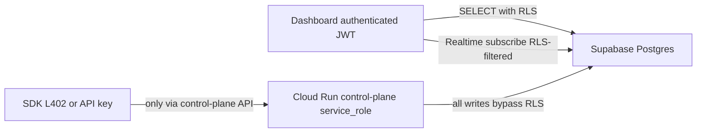

# Sockt MVP — Database schema and Row-Level Security

Single source of truth for Supabase Postgres in the MVP stack (`MVPplans /06-supabase-backend.md`). Cloud Run **control plane** uses the **service role** for all writes and sensitive reads. The **website dashboard** uses the **anon / authenticated** Supabase client for direct reads and Realtime; therefore **RLS is mandatory** on every `public` table.



---

## Tables (MVP — 11 total)

Dropped vs v2 / full spec: `instance_leases`, `rate_limit_buckets`, `host_vms` (Phase 2).

### `users`

One row per dashboard user; `id` matches Supabase Auth `auth.users.id`.

| Column | Type | Constraints | Description |
|--------|------|-------------|-------------|
| `id` | `uuid` | PK, FK → `auth.users(id)` ON DELETE CASCADE | Auth user id |
| `email` | `text` | UNIQUE NOT NULL | Denormalized for convenience |
| `credit_balance_usd_cents` | `bigint` | NOT NULL DEFAULT 0, CHECK (>= 0) | Prepaid credit balance |
| `warning_level` | `text` | NOT NULL DEFAULT `'ok'` | e.g. `ok`, `low_credits`, `out_of_credits`, `suspended` |
| `created_at` | `timestamptz` | NOT NULL DEFAULT `now()` | |

**Indexes:** `users_email_idx` on `(email)`.

---

### `agents`

Lightning / L402 path principals (not website `users`). Agent balance is **prepaid** by paying Sockt-minted **BOLT11 invoices**; there is **no** persisted BOLT12 offer / LNURL handle on this row.

| Column | Type | Constraints | Description |
|--------|------|-------------|-------------|
| `id` | `uuid` | PK, DEFAULT `gen_random_uuid()` | |
| `jwt_sub` | `uuid` | UNIQUE NOT NULL | Stable id for agent JWT `sub` (may mirror a platform-issued identity) |
| `balance_msats` | `bigint` | NOT NULL DEFAULT 0, CHECK (>= -1000000) | Prepaid msats; small negative for in-flight pause |
| `warning_level` | `text` | NOT NULL DEFAULT `'ok'` | e.g. `ok`, `low_balance`, `out_of_balance`, `suspended` |
| `created_at` | `timestamptz` | NOT NULL DEFAULT `now()` | |

**Indexes:** `agents_jwt_sub_idx` on `(jwt_sub)`.

Historical columns removed: `offer_type`, `bolt12_offer`, `lightning_address`.

---

### `api_keys`

Hashed API keys for credit path; raw key never stored.

| Column | Type | Constraints | Description |
|--------|------|-------------|-------------|
| `id` | `uuid` | PK, DEFAULT `gen_random_uuid()` | |
| `user_id` | `uuid` | NOT NULL, FK → `users(id)` ON DELETE CASCADE | Owner |
| `key_hash` | `text` | UNIQUE NOT NULL | SHA-256 (hex or raw bytes as app defines) of raw key |
| `key_prefix` | `text` | NOT NULL | First N chars for display (e.g. 12) |
| `name` | `text` | NOT NULL | User label |
| `is_active` | `boolean` | NOT NULL DEFAULT true | |
| `created_at` | `timestamptz` | NOT NULL DEFAULT `now()` | |
| `last_used_at` | `timestamptz` | nullable | |

**Indexes:** `api_keys_key_hash_idx` on `(key_hash)`; `api_keys_user_id_idx` on `(user_id)`.

---

### `sandboxes`

RunPod-backed sandboxes; either Lightning (`agent_id`) or credits (`user_id` + `api_key_id`).

| Column | Type | Constraints | Description |
|--------|------|-------------|-------------|
| `id` | `uuid` | PK, DEFAULT `gen_random_uuid()` | |
| `agent_id` | `uuid` | nullable, FK → `agents(id)` | Set when `billing_method = 'lightning'` |
| `user_id` | `uuid` | nullable, FK → `users(id)` | Set when `billing_method = 'credits'` |
| `api_key_id` | `uuid` | nullable, FK → `api_keys(id)` | Set for API-key sandboxes |
| `billing_method` | `text` | NOT NULL | `'lightning'` or `'credits'` |
| `tier` | `text` | NOT NULL | e.g. `nano`, `micro`, … |
| `template` | `text` | NOT NULL | Template name / key (matches catalog) |
| `status` | `text` | NOT NULL | e.g. `pending`, `running`, `paused`, `terminated`, `failed_create` |
| `runtime` | `text` | NOT NULL | `'runpod_cpu'` or `'runpod_gpu'` |
| `pod_id` | `text` | nullable | RunPod pod id |
| `pod_proxy_url` | `text` | nullable | Base URL for data plane |
| `network_volume_id` | `text` | nullable | RunPod network volume id |
| `created_at` | `timestamptz` | NOT NULL DEFAULT `now()` | |
| `terminated_at` | `timestamptz` | nullable | Set when fully terminated |

**App constraint (recommended):** exactly one of (`agent_id`) vs (`user_id`, `api_key_id`) consistent with `billing_method`; enforce in app or a CHECK.

**Indexes:** `sandboxes_user_id_idx` on `(user_id)`; `sandboxes_agent_id_idx` on `(agent_id)`; `sandboxes_api_key_id_idx` on `(api_key_id)`.

---

### `tier_pricing`

Reference pricing; seeded by migration.

| Column | Type | Constraints | Description |
|--------|------|-------------|-------------|
| `tier` | `text` | PK | e.g. `nano`, `micro`, `standard`, `gpu_small`, `gpu_large` |
| `msats_per_second` | `bigint` | NOT NULL | Lightning rate |
| `usd_cents_per_second_x100` | `bigint` | NOT NULL | Credit rate at 1/100 cent precision |
| `updated_at` | `timestamptz` | NOT NULL DEFAULT `now()` | |

---

### `templates`

Maps logical templates to RunPod template ids.

| Column | Type | Constraints | Description |
|--------|------|-------------|-------------|
| `id` | `uuid` | PK, DEFAULT `gen_random_uuid()` | |
| `name` | `text` | UNIQUE NOT NULL | Stable key for API / `sandboxes.template` |
| `runpod_template_id` | `text` | NOT NULL | RunPod-side template id |
| `runtime` | `text` | NOT NULL | `'runpod_cpu'` or `'runpod_gpu'` |
| `default_tier` | `text` | NOT NULL | Default `tier` FK conceptually to `tier_pricing.tier` |
| `created_at` | `timestamptz` | NOT NULL DEFAULT `now()` | |

---

### `billing_intervals`

Lightning path: batched consumption audit (~30s intervals from runtime).

| Column | Type | Constraints | Description |
|--------|------|-------------|-------------|
| `id` | `uuid` | PK, DEFAULT `gen_random_uuid()` | |
| `sandbox_id` | `uuid` | NOT NULL, FK → `sandboxes(id)` | |
| `agent_id` | `uuid` | NOT NULL, FK → `agents(id)` | |
| `interval_start` | `timestamptz` | NOT NULL | |
| `interval_end` | `timestamptz` | NOT NULL | |
| `msats_consumed` | `bigint` | NOT NULL | |
| `created_at` | `timestamptz` | NOT NULL DEFAULT `now()` | |

**Indexes:** `billing_intervals_sandbox_created_idx` on `(sandbox_id, created_at DESC)`; `billing_intervals_agent_idx` on `(agent_id)`.

---

### `credit_transactions`

Credit ledger; all amounts positive; meaning by `type`.

| Column | Type | Constraints | Description |
|--------|------|-------------|-------------|
| `id` | `uuid` | PK, DEFAULT `gen_random_uuid()` | |
| `user_id` | `uuid` | NOT NULL, FK → `users(id)` ON DELETE CASCADE | |
| `sandbox_id` | `uuid` | nullable, FK → `sandboxes(id)` | |
| `type` | `text` | NOT NULL | `purchase`, `allocation`, `compute_charge`, `refund`, `adjustment` |
| `amount_usd_cents` | `bigint` | NOT NULL | Always > 0 |
| `balance_after_usd_cents` | `bigint` | NOT NULL | Snapshot after applying this row |
| `description` | `text` | NOT NULL | |
| `stripe_payment_intent_id` | `text` | nullable | Set for `purchase` when applicable |
| `created_at` | `timestamptz` | NOT NULL DEFAULT `now()` | |

**Indexes:** `credit_tx_user_created_idx` on `(user_id, created_at DESC)`; `credit_tx_type_idx` on `(type)`.

---

### `top_up_intervals`

BOLT12 top-up settlements (idempotent).

| Column | Type | Constraints | Description |
|--------|------|-------------|-------------|
| `id` | `uuid` | PK, DEFAULT `gen_random_uuid()` | |
| `agent_id` | `uuid` | NOT NULL, FK → `agents(id)` | |
| `idempotency_key` | `text` | UNIQUE NOT NULL | Caller-supplied |
| `amount_msats` | `bigint` | NOT NULL | |
| `payment_hash` | `bytea` | NOT NULL | |
| `preimage` | `bytea` | nullable | NULL until settled |
| `bolt12_invoice` | `text` | nullable | |
| `status` | `text` | NOT NULL DEFAULT `'pending'` | `pending`, `settled`, `failed` |
| `requested_at` | `timestamptz` | NOT NULL DEFAULT `now()` | |
| `settled_at` | `timestamptz` | nullable | |

**Indexes:** `top_up_agent_requested_idx` on `(agent_id, requested_at DESC)`; `top_up_idempotency_idx` on `(idempotency_key)`; `top_up_payment_hash_idx` on `(payment_hash)`.

---

### `pending_deposits`

Manual BOLT11 deposit tracking (fallback agents).

| Column | Type | Constraints | Description |
|--------|------|-------------|-------------|
| `id` | `uuid` | PK, DEFAULT `gen_random_uuid()` | |
| `agent_id` | `uuid` | NOT NULL, FK → `agents(id)` | |
| `payment_hash` | `bytea` | UNIQUE NOT NULL | |
| `bolt11_invoice` | `text` | NOT NULL | |
| `amount_msats` | `bigint` | NOT NULL | |
| `status` | `text` | NOT NULL DEFAULT `'pending'` | e.g. `pending`, `settled`, `expired`, `failed` |
| `created_at` | `timestamptz` | NOT NULL DEFAULT `now()` | |
| `settled_at` | `timestamptz` | nullable | |

**Indexes:** `pending_deposits_agent_idx` on `(agent_id)`; unique on `(payment_hash)`.

---

### `audit_log`

Append-only events for dashboards/ops (served via backend primarily; still locked down for direct client).

| Column | Type | Constraints | Description |
|--------|------|-------------|-------------|
| `id` | `uuid` | PK, DEFAULT `gen_random_uuid()` | |
| `event_type` | `text` | NOT NULL | |
| `user_id` | `uuid` | nullable, FK → `users(id)` ON DELETE SET NULL | |
| `agent_id` | `uuid` | nullable, FK → `agents(id)` ON DELETE SET NULL | |
| `sandbox_id` | `uuid` | nullable, FK → `sandboxes(id)` ON DELETE SET NULL | |
| `api_key_id` | `uuid` | nullable, FK → `api_keys(id)` ON DELETE SET NULL | |
| `auth_method` | `text` | nullable | e.g. `l402`, `api_key`, `user_jwt` |
| `payload` | `jsonb` | nullable | Arbitrary structured detail |
| `created_at` | `timestamptz` | NOT NULL DEFAULT `now()` | |

**Indexes:** `audit_log_created_idx` on `(created_at DESC)`; optional partial indexes by `event_type` if needed later.

---

## Row-Level Security

### Principles

1. **Enable RLS** on all tables listed above (`ALTER TABLE … ENABLE ROW LEVEL SECURITY`).
2. **Control plane** uses `service_role` → **bypasses RLS** (Postgres superuser-equivalent for policies). No `INSERT`/`UPDATE`/`DELETE` policies for `authenticated` or `anon` — all mutations go through the backend.
3. **Dashboard** uses Supabase JWT (`authenticated`). Only **SELECT** policies where user data or public reference data is needed.
4. **Realtime** inherits the same SELECT visibility as RLS for subscribed tables.

### Policiy summary

| Table | Client roles | Policy |
|--------|--------------|--------|
| `users` | `authenticated` | `SELECT` where `id = auth.uid()` |
| `api_keys` | `authenticated` | `SELECT` where `user_id = auth.uid()` |
| `sandboxes` | `authenticated` | `SELECT` where `user_id = auth.uid()` |
| `credit_transactions` | `authenticated` | `SELECT` where `user_id = auth.uid()` |
| `tier_pricing` | `anon`, `authenticated` | `SELECT` all rows |
| `templates` | `anon`, `authenticated` | `SELECT` all rows |
| `agents` | *(none)* | RLS on; no policy → clients see nothing |
| `billing_intervals` | *(none)* | RLS on; no policy |
| `top_up_intervals` | *(none)* | RLS on; no policy |
| `pending_deposits` | *(none)* | RLS on; no policy |
| `audit_log` | *(none)* | RLS on; no policy |

### Example policy SQL (reference)

Names are suggestions; adjust to your migration style.

```sql
-- users
create policy users_select_own
  on public.users for select
  to authenticated
  using (id = auth.uid());

-- api_keys
create policy api_keys_select_own
  on public.api_keys for select
  to authenticated
  using (user_id = auth.uid());

-- sandboxes (credit-path rows visible to owner; lightning rows have user_id null → not visible via dashboard client)
create policy sandboxes_select_own
  on public.sandboxes for select
  to authenticated
  using (user_id = auth.uid());

-- credit_transactions
create policy credit_transactions_select_own
  on public.credit_transactions for select
  to authenticated
  using (user_id = auth.uid());

-- tier_pricing: public read (pricing page / template picker without login)
create policy tier_pricing_select_all
  on public.tier_pricing for select
  to anon, authenticated
  using (true);

-- templates: public read
create policy templates_select_all
  on public.templates for select
  to anon, authenticated
  using (true);
```

Do **not** add `INSERT`/`UPDATE`/`DELETE` policies for `authenticated`/`anon` on these tables in MVP.

### Optional hardening

- **REVOKE** default `ALL` on `public` tables from `anon`/`authenticated` except what policies grant (project-dependent; Supabase defaults vary).
- Ensure **no** Postgres role used by the browser has bypassrls.

---

## Implementation notes

- **Trigger: `users` row on signup** — On `auth.users` insert, insert matching `public.users` (email sync); implement via Supabase trigger or first-login upsert from control plane.
- **Lightning sandboxes** — `sandboxes.user_id` is null; dashboard client must not see them; listing for L402 users is always via **control plane API**, not direct table read.
- **Migrations** — Implement as SQL under `supabase/migrations/` in a follow-up; this document is the spec only.

---

## Phase 2 (post-MVP)

- Partitioning for `billing_intervals` / `credit_transactions` if write volume grows.
- `instance_leases`, `rate_limit_buckets`, `host_vms` if moving off single-instance patterns.
- Narrower `audit_log` policies if exposing a user-visible activity feed from the client.
