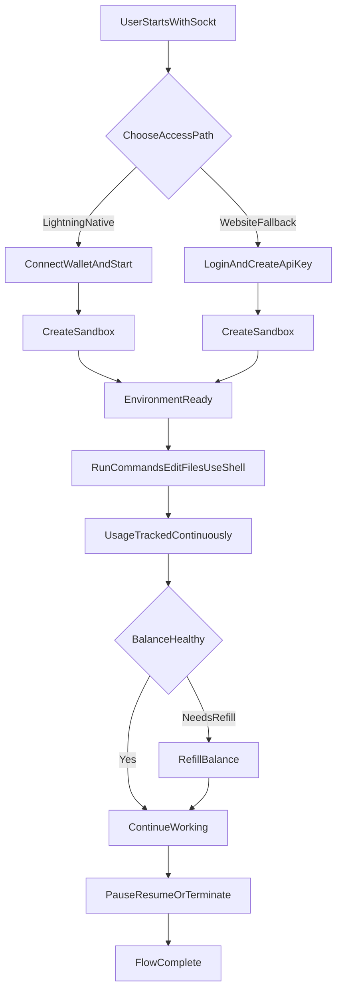
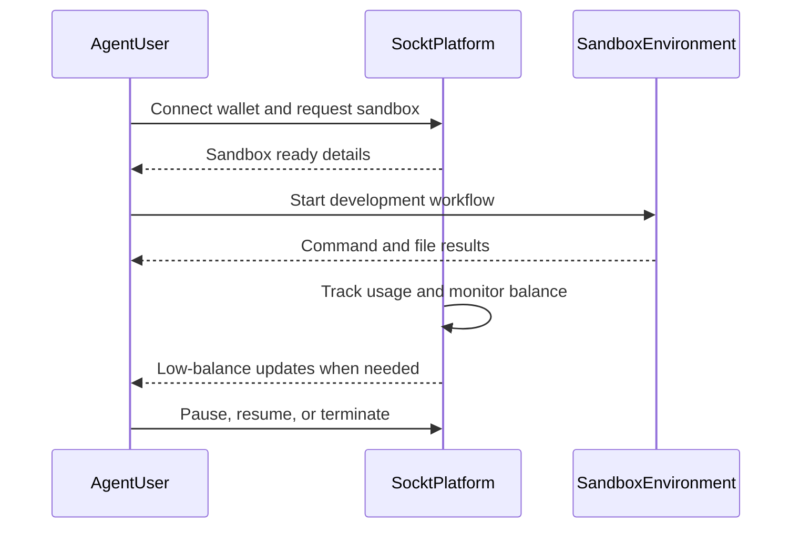
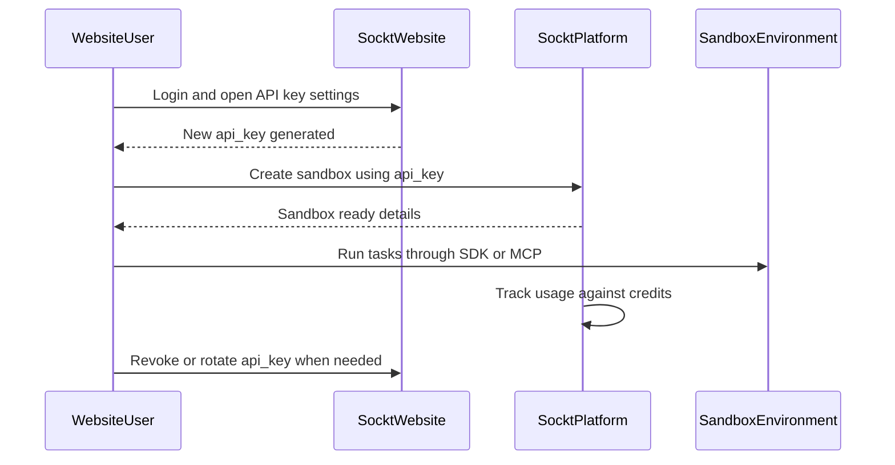

# Sockt End-to-End User Flow

This document is a copywriting-friendly view of the complete Sockt journey. It focuses on user experience and message flow, not backend implementation.

It covers two paths:

- Primary path: Lightning-native onboarding and usage
- Fallback path: website-generated `api_key`

---

## Audience and Journey

- **Developer/Agent user** who wants programmable cloud environments on demand.
- **Website user** who prefers account-based access and API keys.
- **Sockt platform** that provisions environments, tracks usage, and keeps sessions running.

---

## High-Level End-to-End Flow

---

## Primary Path (Lightning-Native)

1. User connects a compatible wallet and starts from the SDK or MCP client.
2. User creates a sandbox for their task.
3. Sockt prepares the sandbox and returns connection details.
4. User starts working: execute code, read/write files, and open a shell.
5. Usage is metered in the background while work continues.
6. When balance gets low, refill is triggered automatically so sessions stay smooth.
7. User can pause, resume, or terminate when done.

### Primary Path Sequence

---

## Fallback Path (Website-Generated API Key)

1. User logs in on the website.
2. User generates an `api_key` from the dashboard.
3. User adds that key to their SDK or MCP setup.
4. User creates and runs a sandbox in the same way as the primary path.
5. Usage is charged against account credits.
6. User can revoke and rotate keys from the dashboard anytime.
7. User keeps the same pause/resume/terminate lifecycle controls.

### Fallback Path Sequence

---

## Messaging Notes for Landing Page Copy

- **One product, two access paths:** Lightning-native or website API key fallback.
- **Fast start:** create a sandbox and begin working in minutes.
- **Smooth runtime:** execute, edit, and shell access in one workflow.
- **Predictable billing:** usage is tracked continuously with clear low-balance handling.
- **User control:** easy pause, resume, terminate, and key rotation.
